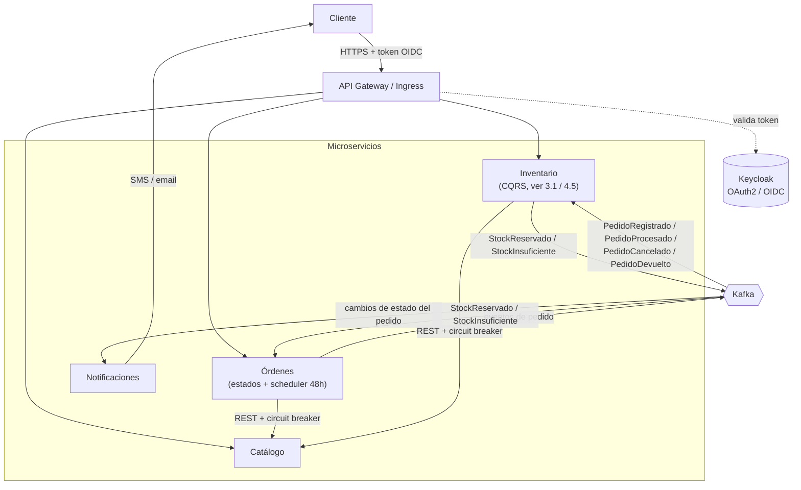
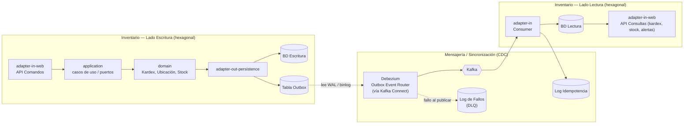

# API de Gestión de Inventario

## 1. Descripción
El siguiente proyecto es un sistema de gestión de inventario y reportes de kardex, compuesto por varios microservicios (**Catálogo**, **Inventario**, **Órdenes** y **Notificaciones**, ver 4.1), desarrollado en JAVA 21 con Spring Boot y Webflux.

## 2. Requisitos de Usuario
* Registrar guías de remisión: todo ingreso debe estar asociado a un documento de compra, pudiendo ser de cualquier tipo. Actualmente se soportan boleta, factura y orden de compra, pero el tipo de documento debe quedar abierto a futuros tipos.
* Asignar ubicación a los productos ingresados.
* Registrar pedidos: el pedido se registra siempre, independientemente de si hay stock disponible. Si hay stock disponible (stock real − stock reservado) para **todos** sus ítems, se bloquea (reserva) el inventario correspondiente; si falta stock de algún ítem, no se bloquea nada (todo o nada), el pedido queda **pendiente** y se genera una alerta de stock faltante. Un pedido pendiente no se puede procesar hasta que su stock quede reservado.
* Si el pedido no se ha procesado en 48 horas desde su registro (ya sea por falta de stock o cualquier otro motivo), este se cancela automáticamente y se libera el stock bloqueado, si lo hubiera.
* El pedido sigue un ciclo de vida con estados definidos (ver 2.1 Máquina de estados del pedido), que incluye procesarlo, enviarlo, entregarlo y, de corresponder, cancelarlo o aceptar una devolución.
* Debe mantenerse un registro de incidencias con el historial de eventos relevantes (por ejemplo, pedidos cancelados o devueltos y su motivo), para trazabilidad y auditoría.
* Debe poderse tener alertas por 
    * Stock mínimo de un artículo.
    * Pedido cancelado.
    * Solicitud de pedido de artículo sin stock.
    * Registro de entradas o salidas inusuales (ver 2.2 Criterio de movimiento inusual).

### 2.1 Máquina de estados del pedido

Conceptos de stock (ver `domain-model.md`, Inventario): **stock real** = existencia física; **stock reservado** = bloqueado por pedidos; **stock disponible** = real − reservado (calculado, no se almacena).

* `REGISTRADO` (inicial): el pedido se crea siempre al registrarse; queda en este estado mientras Inventario verifica el stock (asíncrono, ver 4.2).
* `PENDIENTE`: no hay stock disponible para todos los ítems; no se bloquea nada y se genera la alerta de stock faltante. **No se puede procesar.** Pasa a `RESERVADO` automáticamente cuando ingresa stock suficiente (Inventario reintenta la reserva, en orden de llegada).
* `RESERVADO`: el stock de todos los ítems está bloqueado (sube el reservado; el real no cambia). **Es el único estado desde el que se puede procesar.**
* `PROCESADO`: el pedido fue procesado (paso explícito, no automático). Recién aquí se descuenta el stock **real** y el **reservado**, generando la salida en el kardex.
* `ENVIADO`: el pedido está en camino al cliente.
* `ENTREGADO` (final): el pedido fue entregado; el stock no se repone.
* `DEVUELTO` (final, auxiliar): solo alcanzable desde `ENTREGADO`; el cliente devuelve el pedido y se repone el stock real (entrada en el kardex).
* `CANCELADO` (final, auxiliar):
  * Desde `REGISTRADO`, `PENDIENTE` o `RESERVADO` (automático a las 48 horas sin procesar, o manual): se libera el stock reservado, si lo hubiera; el real no cambia.
  * Desde `PROCESADO` (manual, antes de enviar): como el stock real ya se descontó, se **repone** (entrada en el kardex).

Transiciones permitidas:

```
REGISTRADO → RESERVADO   (hay stock: StockReservado)
REGISTRADO → PENDIENTE   (falta stock: StockInsuficiente)
PENDIENTE  → RESERVADO   (ingresó stock suficiente: StockReservado)
RESERVADO  → PROCESADO   (paso explícito)
PROCESADO  → ENVIADO
ENVIADO    → ENTREGADO
ENTREGADO  → DEVUELTO
REGISTRADO / PENDIENTE / RESERVADO → CANCELADO   (automático a las 48h sin procesar, o manual)
PROCESADO  → CANCELADO   (manual, antes de enviar)
```

Toda transición hacia `CANCELADO` o `DEVUELTO` debe quedar registrada en el registro de incidencias junto con su motivo.

### 2.2 Criterio de movimiento inusual (entrada/salida)

Un movimiento de entrada o salida de kardex se considera inusual cuando la diferencia entre su **fecha de creación** (cuando se registra en el sistema) y su **fecha de documento** (la fecha que figura en el documento de respaldo) supera las 48 horas, en cualquier dirección. Esta discrepancia puede indicar un intento de manipular el kardex para encubrir robo o pérdida de inventario, por lo que debe disparar la alerta correspondiente.


## 3. Requisitos de Software
* El proceso de registrar una guía de remisión y asignación de ubicación son procesos separados.
* Los productos se pueden trasladar entre ubicaciones.
* Los procesos de mensajería son asíncronos y deben ser ejecutados por una cola.
* El patrón CQRS se aplica solo donde hay necesidad real de reportes: hoy, en **Inventario** (reportes de kardex), que tendrá BD de lectura y BD de escritura (ver 3.1 Sincronización CQRS). Los demás microservicios (Catálogo, Órdenes) usan una única BD; Órdenes reutiliza solo la parte de Outbox + Relay de ese mismo patrón para publicar sus eventos de pedido de forma confiable, sin necesitar una BD de lectura separada.
* El sistema debe desarrollarse en una arquitectura hexagonal (puertos y adaptadores).

### 3.1 Sincronización CQRS (escritura → lectura)

Aplica íntegramente dentro del microservicio **Inventario** (ver 4.1). Los demás servicios con eventos propios (ej. Órdenes) reutilizan solo el Outbox + Relay, sin BD de lectura separada.

* **Lado escritura (dentro de Inventario)**: expone los comandos, escribe en la BD de escritura y, en la misma transacción, graba el evento en una tabla outbox (patrón Outbox), evitando el problema de doble escritura entre BD y cola.
* **Relay vía CDC (Debezium)**: en vez de un relay por polling, se usa **Debezium** leyendo el log de transacciones de la BD de escritura (WAL/binlog), con el **Outbox Event Router** de Debezium publicando directo a Kafka (vía Kafka Connect). Esto evita la carga de polling sobre la BD y los problemas de concurrencia de un poller con múltiples instancias (`SELECT ... FOR UPDATE SKIP LOCKED`). Se eligió sobre polling por la latencia más baja y porque Debezium ya tiene soporte nativo para el patrón Outbox. Requiere habilitar replicación lógica en la BD de escritura y desplegar Kafka Connect junto al resto del stack. Se mantiene una tabla/log de idempotencia (por ID único de evento) del lado del consumidor para garantizar que un mismo evento no se aplique dos veces.
* **Lado lectura (dentro de Inventario)**: consume los eventos de Kafka y actualiza la BD de lectura, validando idempotencia antes de aplicar cada evento.
* **Fallos de sincronización**: si Debezium/Kafka Connect no logra publicar un evento, o el lado de lectura no logra aplicarlo, se registra en un log de fallos de sincronización (dead-letter / DLQ de Kafka) y se dispara una alerta, para permitir revisión y reintento manual. Este log es de naturaleza técnica/infraestructura, distinto del registro de incidencias de negocio (sección 2).


## 4. Arquitectura

### 4.1 Microservicios

| Microservicio | Responsabilidad | Persistencia |
|---|---|---|
| **Catálogo** | Maestro de productos: SKU, nombre, categoría, unidad de medida, stock mínimo configurado. | BD única (CRUD). |
| **Inventario** | Guías de remisión, ubicaciones, traslados, kardex, bloqueo/liberación de stock, alertas de stock mínimo / movimiento inusual / stock insuficiente. | CQRS: BD escritura + BD lectura + outbox + relay (ver 3.1), por los reportes de kardex. |
| **Órdenes** | Máquina de estados del pedido (2.1), scheduler de 48h, registro de incidencias (cancelaciones/devoluciones con motivo). | BD única + tabla outbox (para publicar eventos de pedido de forma confiable). |
| **Notificaciones** | Consume cambios de estado del pedido y notifica al cliente por SMS/email. | BD pequeña: registro de notificaciones enviadas (idempotencia y auditoría). |

Catálogo se consulta de forma **síncrona** (REST, con circuit breaker + retries) desde Inventario y Órdenes cuando necesitan datos de producto — no participa del flujo asíncrono de stock.

### 4.2 Verificación de stock (saga asíncrona vía Kafka)

Como el pedido se registra siempre, haya o no stock (sección 2), la verificación de stock entre Órdenes e Inventario es **asíncrona y coreografiada por eventos** — no hay llamada síncrona ni se bloquea la respuesta al cliente esperando la verificación:

1. Cliente registra pedido → **Órdenes** lo guarda en `REGISTRADO` y publica (vía su outbox) el evento `PedidoRegistrado`.
2. **Inventario** consume `PedidoRegistrado` e intenta reservar el stock (todo o nada, sobre el stock disponible):
   * Hay stock disponible para todos los ítems → lo reserva y publica `StockReservado`.
   * Falta stock de algún ítem → no reserva nada, deja la reserva en espera, dispara la alerta "solicitud de pedido sin stock" y publica `StockInsuficiente`.
   * Cuando ingresa stock (guía de remisión o devolución), reintenta las reservas en espera en orden de llegada; si ahora alcanza, publica `StockReservado`.
3. **Órdenes** consume el resultado: `StockReservado` → pasa a `RESERVADO` (desde `REGISTRADO` o `PENDIENTE`) y publica `PedidoReservado`; `StockInsuficiente` → pasa a `PENDIENTE` y publica `PedidoPendiente`.
4. El pedido se **procesa** como paso explícito (solo desde `RESERVADO`): Órdenes pasa a `PROCESADO` y publica `PedidoProcesado`; Inventario lo consume y descuenta el stock real y el reservado (salida en el kardex).
5. El scheduler de 48h (en Órdenes) cancela los pedidos sin procesar (`REGISTRADO`, `PENDIENTE`, `RESERVADO`) y publica `PedidoCancelado`; Inventario libera la reserva si la había. Si la cancelación es manual desde `PROCESADO`, Inventario repone el stock real. Ante `PedidoDevuelto`, Inventario repone el stock real.
6. **Notificaciones** consume los eventos de cambio de estado (`PedidoRegistrado`, `PedidoPendiente`, `PedidoReservado` —solo si venía de `PENDIENTE`—, `PedidoEnviado`, `PedidoEntregado`, `PedidoCancelado`, `PedidoDevuelto`) y notifica al cliente. `PedidoProcesado` no se notifica.

### 4.3 Alertas y registro de incidencias

* El **registro de incidencias** (cancelaciones/devoluciones con motivo) vive dentro de **Órdenes**, que es quien controla el ciclo de vida del pedido.
* Las **alertas operativas** (stock mínimo, movimiento inusual, stock insuficiente, pedido cancelado, fallo de sincronización) no requieren un microservicio propio: cada servicio que las origina (Inventario u Órdenes) expone su propio endpoint de "alertas activas" como parte de su API de consultas.
* El **panel de alertas urgentes del administrador** (frontend, a futuro) combina esas dos fuentes llamando a ambos endpoints — no hay un agregador backend dedicado. Con solo dos fuentes hoy, agregar un microservicio de Alertas solo para esto no se justifica; si en el futuro se suman más fuentes (ej. Catálogo, Notificaciones), se puede reconsiderar un agregador dedicado.

### 4.4 Diagrama general



### 4.5 Diagrama detallado: CQRS dentro de Inventario



## 5. Stack Transversal

Aplica a los cuatro microservicios.

| Aspecto | Tecnología | Notas |
|---|---|---|
| Seguridad | Keycloak (OAuth2/OIDC) | Cada microservicio actúa como resource server; autorización por roles. |
| Trazabilidad | OpenTelemetry → Jaeger o Tempo | El traceId se propaga también a través de los headers de los mensajes de Kafka, no solo en llamadas HTTP síncronas. |
| Logs | JSON estructurado con traceId → Loki o ELK | Permite correlacionar logs entre microservicios usando el mismo traceId de OpenTelemetry. |
| Métricas | Prometheus + Grafana | Dashboard versionado en el repo; también soporta las alertas operativas (ver 4.3). |
| Resiliencia | Resilience4j (circuit breaker + retry + timeout) en llamadas síncronas y a proveedores externos; reintentos acotados + DLQ en Kafka para los consumidores de eventos. | **Ningún reintento es infinito** — ver 5.1. |
| Tests | Testcontainers (BD/Kafka reales en tests), tests de contrato entre microservicios, ArchUnit (reglas de arquitectura hexagonal). | |
| CI | GitHub Actions: build, tests e imagen publicada en GHCR por cada microservicio. | |
| Despliegue | Docker Compose (desarrollo local) y Kubernetes local con kind + Helm o Kustomize. | |

### 5.1 Política de reintentos (sin reintentos infinitos)

Regla general (decidida 2026-11-01): **en ningún punto del sistema —consumidores de Kafka, sincronización CQRS, Debezium/Kafka Connect, llamadas síncronas ni proveedores externos— hay reintentos infinitos.** Todo reintento tiene un máximo explícito y, al agotarse, el mensaje u operación termina en un destino visible (DLQ, estado `FAILED`, alerta o métrica) para revisión manual. Los valores de abajo son los iniciales y se configuran por propiedades, no van fijos en código.

| Punto | Mecanismo | Reintentos (valores iniciales) | Al agotarse |
|---|---|---|---|
| Consumidores de Kafka (los 4 microservicios, incluido el lado lectura CQRS de Inventario) | Spring Kafka `DefaultErrorHandler` + `ExponentialBackOff` | **3 reintentos** (4 intentos en total), espera 1 s → 2 s → 4 s | `DeadLetterPublishingRecoverer` → topic DLQ (`<topic>.DLT`). En el lado lectura de Inventario, además, alerta `SYNC_FAILURE` (3.1). |
| Errores no recuperables en consumidores (deserialización, validación, regla de negocio) | Clasificados como *not retryable* | **0** | Directo a la DLQ. |
| Debezium / Kafka Connect (relay del outbox) | `errors.max.retries` del conector (**por defecto Debezium usa `-1` = infinito**: se debe sobrescribir) | **5 reintentos** con espera entre reinicios (`retriable.restart.connector.wait.ms` = 10 s) | El conector queda en estado `FAILED` → alerta en Prometheus/Grafana (métricas de Kafka Connect) → reinicio manual. Los eventos no se pierden: siguen en la tabla outbox / WAL. |
| Productores de Kafka (Debezium) | `retries` + `delivery.timeout.ms` | Acotados por tiempo: `delivery.timeout.ms` = 120 s | Error del productor → cuenta como fallo del conector (fila anterior). |
| Llamadas síncronas a Catálogo (desde Inventario y Órdenes) | Resilience4j: TimeLimiter + Retry + CircuitBreaker | Timeout 2 s; **2 reintentos** (3 intentos), espera 200 ms → 400 ms | Error al cliente (ej. 503). Circuit breaker: ventana de 20 llamadas, se abre con ≥ 50 % de fallos, queda abierto 30 s, luego 5 llamadas de prueba (half-open). Con el circuito abierto se falla de inmediato, sin llamar a Catálogo. |
| Proveedores de email/SMS (Notificaciones) | Resilience4j: TimeLimiter + Retry + CircuitBreaker, uno por proveedor | Timeout 5 s; **3 reintentos** (4 intentos), espera 2 s → 4 s → 8 s | Notificación en `FAILED` + mensaje a la DLQ. El consumidor de Kafka **no** reintenta además por su cuenta (ver nota). Circuit breaker con los mismos umbrales que Catálogo. |
| DLQ | — | **0** (no hay reprocesamiento automático) | Reprocesamiento **manual** (herramienta/endpoint administrativo), para no volver a un ciclo de reintentos. |
| Reservas `PENDING` (saga de stock, negocio) | Reintento ante cada ingreso de stock | Acotado por tiempo: el pedido expira (48 h configurables) y se libera | Pedido `CANCELLED` por expiración. |

**Nota — no multiplicar reintentos**: cada operación reintenta en **una sola capa**. Si una llamada interna ya tiene su propio Retry de Resilience4j (Catálogo, proveedores), el error que finalmente escapa no debe volver a reintentarse completo en el consumidor de Kafka (3 × 4 = 12 intentos). Para eso, la excepción final de Resilience4j (incluido `CallNotPermittedException` del circuito abierto) se clasifica como *not retryable* en el `DefaultErrorHandler` y va directo a la DLQ.
