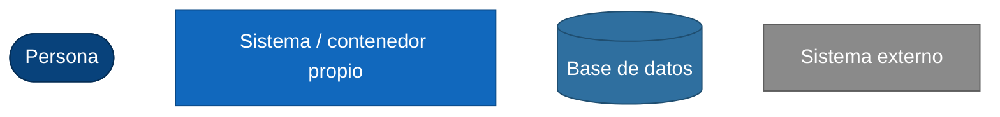
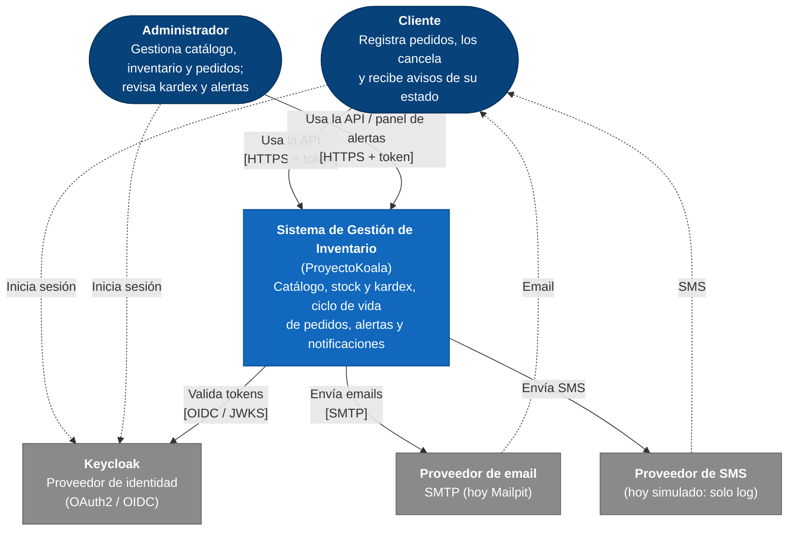
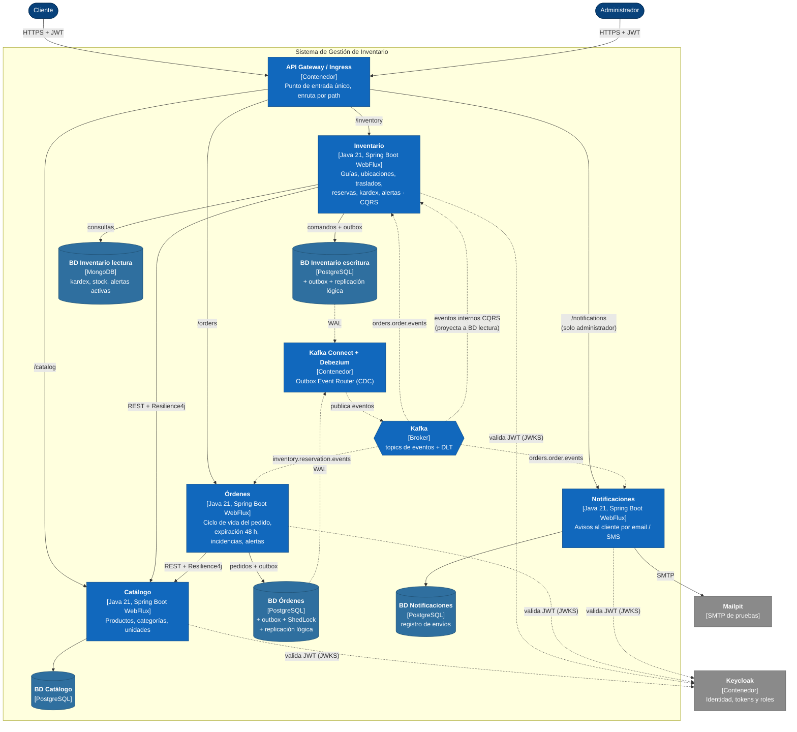
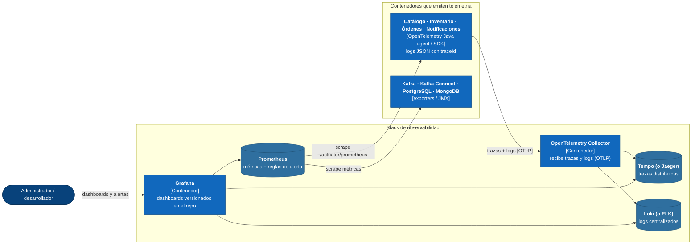
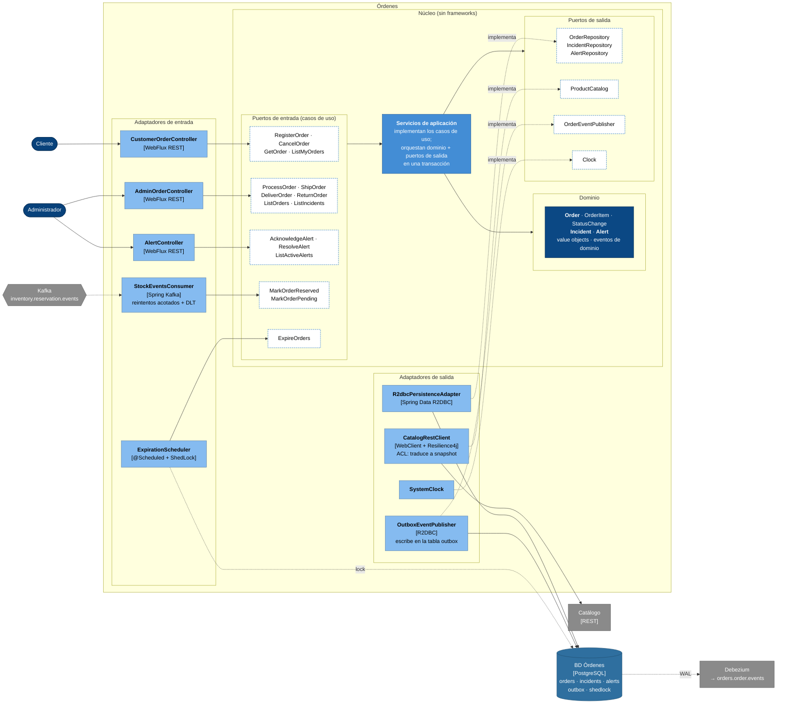
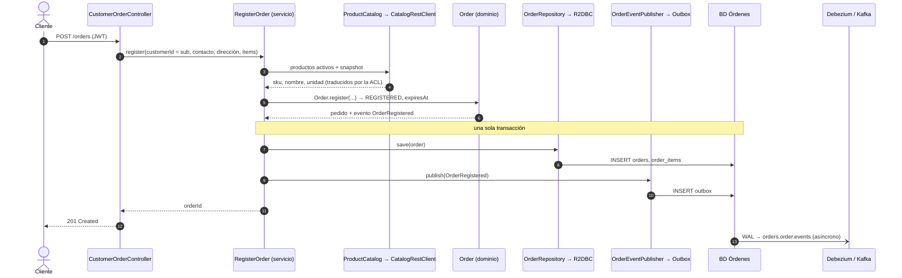

# Diagramas de Arquitectura (Modelo C4)

Vista de la arquitectura en tres niveles del [modelo C4](https://c4model.com/), para evaluarla sin leer código:

1. **Contexto**: el sistema, sus usuarios y los sistemas externos.
2. **Contenedores**: lo que se despliega (servicios, bases de datos, Kafka, Keycloak, observabilidad).
3. **Componentes**: el interior de **Órdenes**, con su arquitectura hexagonal.

Las relaciones entre contextos (patrones DDD) están en `docs/architecture/context-map.md`, el modelo de dominio en `docs/domain-model.md` y los escenarios de calidad que esta arquitectura debe cumplir en `docs/architecture/quality-attributes.md`. Los diagramas usan Mermaid, que GitHub muestra directamente.

**Leyenda común**



Las flechas indican quién inicia la comunicación. Las líneas punteadas son asíncronas (eventos o lectura del log de la BD).

---

## Nivel 1: Contexto del sistema



| Elemento | Tipo | Descripción |
|---|---|---|
| Cliente | Persona | Registra y cancela sus pedidos (antes de procesarlos) y recibe avisos por email y/o SMS. Hoy usa la API directamente; su frontend está fuera de alcance (`docs/vision.md` 3). |
| Administrador | Persona | Gestiona catálogo, guías de remisión, ubicaciones y traslados; avanza los pedidos (procesar, enviar, entregar, devolver); consulta el kardex y las alertas. El panel de administrador es un frontend a futuro. |
| Sistema de Gestión de Inventario | Sistema propio | Lo que se construye en este repo. Se abre en el nivel 2. |
| Keycloak | Externo | Emite los tokens y define los roles. Se despliega junto al sistema, pero no se desarrolla: se usa tal cual (context-map R5). |
| Proveedor de email | Externo | Hoy Mailpit, un servidor SMTP de pruebas en Docker Compose; un proveedor real se agrega como adaptador (quality-attributes M2). |
| Proveedor de SMS | Externo | Hoy simulado: el adaptador solo escribe en el log. |

**Fuera del sistema a propósito**: pasarela de pagos y facturación electrónica real. El documento de compra de una guía se registra, pero no se valida contra un ente externo (`docs/vision.md` 3).

**Más roles a futuro** (ej. almacenero, operador logístico): se agregan como roles en Keycloak y no cambian este diagrama.

---

## Nivel 2: Contenedores

Por legibilidad, el nivel 2 se muestra en dos vistas del mismo conjunto de contenedores: **2a**, el flujo de negocio, y **2b**, la observabilidad. La tabla del final lista todos los contenedores.

### 2a. Flujo de negocio



**Lo que este diagrama hace visible:**

* **Cada servicio tiene su propia BD**, y nadie lee la BD de otro (context-map, regla 1).
* **Los servicios nunca publican directo a Kafka**: escriben el evento en su outbox, en la misma transacción que el cambio. Debezium lo lee del WAL y lo publica. Por eso las dos BD con outbox requieren replicación lógica.
* **Órdenes e Inventario no se llaman entre sí**: solo se hablan por Kafka (la saga, README 4.2). La única dependencia síncrona es hacia Catálogo, protegida con Resilience4j.
* **El lado de lectura de Inventario** es el mismo servicio, consumiendo sus propios eventos internos para proyectar la BD de lectura (README 3.1).
* **El SMS no aparece como contenedor** porque hoy es un adaptador dentro de Notificaciones que solo escribe en el log.

### 2b. Observabilidad



* **El `traceId` cruza Kafka** en el header `traceparent`, así un pedido produce una sola traza de punta a punta (quality-attributes O1).
* **Grafana correlaciona las tres señales**: de una traza en Tempo se salta a sus logs en Loki por el mismo `traceId`.
* **Las alertas operativas** (conector de Debezium en `FAILED`, mensajes en la DLT, circuito abierto, retraso del lado de lectura) se definen como reglas en Prometheus y se ven en Grafana (quality-attributes D3, O2, R3).

### Contenedores

| Contenedor | Tecnología | Responsabilidad | Datos |
|---|---|---|---|
| API Gateway / Ingress | Por decidir (ej. Spring Cloud Gateway o el Ingress de Kubernetes) | Punto de entrada único; enruta por path. La validación del token la hace cada servicio, no solo el gateway. | — |
| Catálogo | Java 21, Spring Boot, WebFlux | Maestro de productos, categorías y unidades de medida. No consume eventos ni llama a nadie. | BD Catálogo |
| Inventario | Java 21, Spring Boot, WebFlux | Guías, ubicaciones, traslados, reservas, kardex, alertas. Único con CQRS. | BD escritura (PostgreSQL) + BD lectura (MongoDB) |
| Órdenes | Java 21, Spring Boot, WebFlux | Ciclo de vida del pedido, expiración, incidencias, alertas `ORDER_CANCELLED`. | BD Órdenes |
| Notificaciones | Java 21, Spring Boot, WebFlux | Consume eventos de pedido y avisa al cliente; consulta de envíos para el administrador. | BD Notificaciones |
| BD por servicio | PostgreSQL | Todas las BD transaccionales: Catálogo, Inventario escritura, Órdenes y Notificaciones. Una base y un usuario por servicio, nunca compartidos; la instancia depende del entorno (ADR-0003). Las de Inventario escritura y Órdenes tienen replicación lógica para Debezium. | — |
| BD de lectura de Inventario | MongoDB | Modelos de lectura del CQRS (`KardexEntry`, `ProductStockView`, `ActiveAlertView`) como documentos listos para consultar, más el log de idempotencia del proyector. Solo la escribe el proyector de Inventario. | Proyecciones |
| Kafka | Apache Kafka | Topics de eventos entre servicios, topic interno del CQRS de Inventario (`inventory.internal.events`) y sus `.DLT`. | Eventos |
| Kafka Connect + Debezium | Debezium (Outbox Event Router) | Lee el outbox del WAL y publica en Kafka. `errors.max.retries=5` (README 5.1). | Offsets en topics internos de Connect |
| Keycloak | Keycloak | Identidad, tokens y roles. | Su propia BD (quinta base de la instancia compartida en desarrollo, aislada en certificación y producción; ADR-0003) |
| Mailpit | Mailpit | SMTP de pruebas con interfaz web para ver los emails enviados. | — |
| OpenTelemetry Collector | OTel Collector | Recibe trazas y logs por OTLP y los reenvía. | — |
| Tempo (o Jaeger) | Grafana Tempo | Almacén de trazas. | Trazas |
| Loki (o ELK) | Grafana Loki | Almacén de logs. | Logs |
| Prometheus | Prometheus | Métricas y reglas de alerta. | Series de tiempo |
| Grafana | Grafana | Dashboards versionados en el repo y alertas. | — |

---

## Nivel 3: Componentes de Órdenes (hexagonal)

Órdenes por dentro, en puertos y adaptadores. El dominio y la aplicación no dependen de Spring, de la BD ni de Kafka: solo los adaptadores conocen la tecnología.



Cómo leerlo: los adaptadores de entrada llaman a los puertos de entrada; los servicios de aplicación usan el dominio y los puertos de salida; los adaptadores de salida **implementan** esos puertos (flecha punteada). Todas las dependencias del código apuntan hacia el núcleo.

### Componentes

| Componente | Capa | Responsabilidad |
|---|---|---|
| `CustomerOrderController` | Adaptador de entrada | API del cliente: registrar, cancelar, consultar y listar sus pedidos. Toma el `customerId` del `sub` del token. Si el pedido es de otro cliente, responde 404 (quality-attributes S2). |
| `AdminOrderController` | Adaptador de entrada | API del administrador: procesar, enviar, entregar, cancelar (también desde `PROCESSED`), devolver, listar pedidos e incidencias. Requiere el rol de administrador. |
| `AlertController` | Adaptador de entrada | Endpoint de alertas activas de Órdenes, que consume el panel (context-map R7). |
| `StockEventsConsumer` | Adaptador de entrada | Consume `StockReserved`/`StockInsufficient`; descarta duplicados por `eventId` y los eventos que llegan con el pedido en un estado incompatible (`domain-model.md`, Órdenes). 3 reintentos y luego la DLT (README 5.1). |
| `ExpirationScheduler` | Adaptador de entrada | Dispara `ExpireOrders` periódicamente; ShedLock asegura que corra en una sola instancia. |
| Puertos de entrada | Aplicación | Una interfaz por caso de uso (`domain-model.md`, Órdenes, "Casos de uso"). Los adaptadores dependen solo de estas interfaces. |
| Servicios de aplicación | Aplicación | Implementan los casos de uso: cargan el agregado, invocan la operación de dominio, guardan y registran el evento, **todo en una transacción** (`Order` + `Incident` + `Alert` + outbox, `domain-model.md`). |
| `Order`, `Incident`, `Alert` | Dominio | Reglas de negocio: máquina de estados (README 2.1), reglas de cancelación por actor, motivo obligatorio, inmutabilidad de los datos del pedido. Generan los eventos de dominio. |
| `OrderRepository`, `IncidentRepository`, `AlertRepository` | Puerto de salida | Guardar y cargar agregados, con bloqueo optimista por `version`. |
| `ProductCatalog` | Puerto de salida | Obtener del catálogo los productos activos y su snapshot, expresados en términos de Órdenes. |
| `OrderEventPublisher` | Puerto de salida | Registrar los eventos de dominio para su publicación. El dominio no sabe que existe Kafka. |
| `Clock` | Puerto de salida | Hora actual inyectable, para probar `expiresAt` y la expiración sin esperar 48 h. |
| `R2dbcPersistenceAdapter` | Adaptador de salida | Mapea los agregados a tablas con Spring Data R2DBC. Las entidades de persistencia están separadas de las del dominio. |
| `CatalogRestClient` | Adaptador de salida (ACL) | Llama a Catálogo con WebClient y Resilience4j (timeout 2 s, 2 reintentos, circuit breaker) y traduce la respuesta al snapshot de `OrderItem` (context-map R2). |
| `OutboxEventPublisher` | Adaptador de salida | Escribe el evento en la tabla `outbox` dentro de la transacción en curso. Debezium lo publica después en `orders.order.events`. |
| `SystemClock` | Adaptador de salida | Implementación real de `Clock`. |

### Flujo de ejemplo: registrar un pedido



Si Catálogo falla, el paso 3 termina en 503 y no se escribe nada (quality-attributes D2). La reserva de stock ocurre después y de forma asíncrona (README 4.2), sin bloquear la respuesta al cliente.

### Estructura de paquetes y reglas de ArchUnit

```text
orders
├── domain                 ← Order, Incident, Alert, value objects, eventos (sin Spring)
├── application
│   ├── port
│   │   ├── in             ← interfaces de los casos de uso
│   │   └── out            ← OrderRepository, ProductCatalog, OrderEventPublisher, Clock
│   └── service            ← implementaciones de los casos de uso
└── adapter
    ├── in
    │   ├── web            ← controllers WebFlux
    │   ├── kafka          ← StockEventsConsumer
    │   └── scheduler      ← ExpirationScheduler
    └── out
        ├── persistence    ← R2DBC
        ├── catalog        ← CatalogRestClient (ACL)
        └── outbox         ← OutboxEventPublisher
```

Reglas que ArchUnit verifica en CI (README 5, quality-attributes M2):

1. `domain` no depende de ningún otro paquete de la aplicación, ni de Spring, Reactor, R2DBC o Kafka.
2. `application` depende solo de `domain` (y de Reactor, por ser WebFlux de punta a punta). No depende de `adapter`.
3. Los adaptadores no se llaman entre sí: un adaptador de entrada solo usa `application.port.in`.
4. Solo `adapter.out.*` implementa las interfaces de `application.port.out`.

La misma estructura se repite en los otros tres servicios. En Inventario, `adapter.in` agrega el consumidor del lado de lectura y `adapter.out` agrega el repositorio de la BD de lectura (Spring Data MongoDB Reactive).
