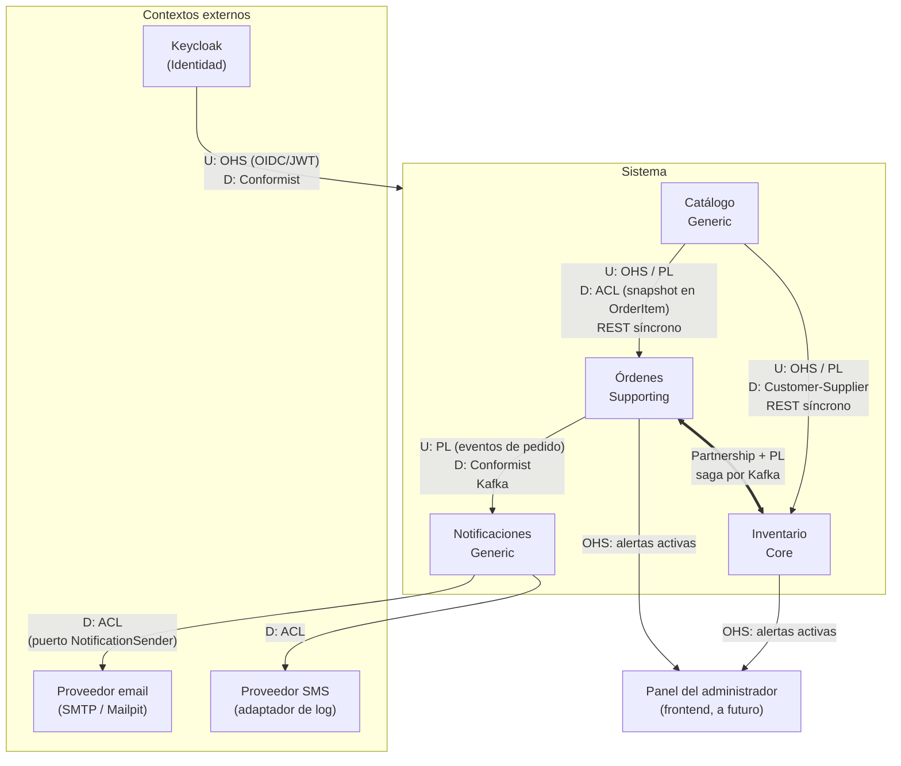

# Mapa de Contextos

Diseño estratégico (DDD) del sistema: qué subdominios hay, qué *bounded context* atiende a cada uno y cómo se relacionan entre sí. Complementa a `docs/README.md` (sección 4, arquitectura) y a `docs/domain-model.md` (diseño táctico de cada contexto). Los nombres en código siguen `docs/glosario.md`.

## 1. Subdominios

| Subdominio | Tipo | Bounded context | Por qué |
|---|---|---|---|
| Control de stock y kardex | **Core** | Inventario | Es el valor del sistema: stock confiable, reservas, kardex auditable y detección de movimientos inusuales (posible manipulación). Concentra la mayor inversión: CQRS, outbox + CDC, modelo de lectura propio. |
| Gestión de pedidos | **Supporting** | Órdenes | Reglas propias (máquina de estados, expiración a 48 h, incidencias), pero existe para alimentar al core; no es el diferenciador. |
| Maestro de productos | **Generic** | Catálogo | CRUD de datos maestros (producto, categoría, unidad de medida). Sin reglas de negocio relevantes. |
| Comunicación con el cliente | **Generic** | Notificaciones | Envío de avisos por email/SMS a partir de eventos. Podría reemplazarse por un servicio de terceros. |
| Identidad y acceso | **Generic** (externo) | Keycloak | Se adopta tal cual; no se desarrolla. |

**Consecuencia práctica**: los patrones más costosos (CQRS, BD de lectura, reportes) se aplican solo en Inventario. Catálogo y Notificaciones se mantienen lo más simples posible.

## 2. Diagrama

Notación: **U** = upstream (define el modelo o contrato), **D** = downstream (lo consume). Las flechas van de upstream a downstream.

Los proveedores de email/SMS son upstream técnicos de Notificaciones (ellos definen su API), aunque la flecha se dibuje en el sentido de la llamada.

## 3. Relaciones

| # | Upstream → Downstream | Patrón | Integración | Contrato | Si falla |
|---|---|---|---|---|---|
| R1 | Catálogo → Inventario | **Open Host Service + Published Language** (Catálogo) / **Customer-Supplier** (Inventario) | REST síncrono | API de lectura de productos: existencia/estado activo y `minimumStock` | Resilience4j: timeout 2 s, 2 reintentos, circuit breaker (README 5.1). La operación de Inventario falla (ej. 503); no se registra con datos a medias. |
| R2 | Catálogo → Órdenes | **OHS + PL** (Catálogo) / **Anticorruption Layer** (Órdenes) | REST síncrono, solo al registrar el pedido | API de lectura de productos: estado activo, `sku`, `name`, unidad de medida | Igual que R1: el pedido no se registra y el cliente recibe error. |
| R3 | Órdenes ⇄ Inventario | **Partnership** + **Published Language** | Asíncrono, Kafka (saga coreografiada, README 4.2), publicando vía outbox + Debezium | Eventos de pedido ↔ eventos de reserva (sección 5) | Consumidores: 3 reintentos y DLQ. Lo que no se resuelve lo cubre la expiración a 48 h. |
| R4 | Órdenes → Notificaciones | **Published Language** (Órdenes) / **Conformist** (Notificaciones) | Asíncrono, Kafka | Los mismos eventos de pedido de R3; cada uno trae `contact` | Notificación en `FAILED` + DLQ. No afecta al pedido. |
| R5 | Keycloak → todos | **OHS** (OIDC) / **Conformist** | Token JWT validado por cada microservicio (resource server) | Claims estándar; `sub` se usa como `customerId` en Órdenes | Sin token válido, la API responde 401/403. |
| R6 | Proveedores email/SMS → Notificaciones | **Anticorruption Layer** (Notificaciones) | SMTP / adaptador de log, detrás del puerto `NotificationSender` | API del proveedor, aislada en el adaptador | Timeout 5 s, 3 reintentos, circuit breaker, luego `FAILED` (README 5.1). |
| R7 | Inventario y Órdenes → Panel del administrador | **OHS** | REST; el panel combina las dos fuentes en el cliente (README 4.3) | Endpoint de "alertas activas" de cada servicio | El panel muestra la fuente que responda. |

### 3.1 Por qué cada patrón

* **R1, Customer-Supplier**: Inventario necesita de Catálogo pocos datos (que el producto exista y su `minimumStock`) y los consulta en el momento sin guardar copia. Como Catálogo es del mismo equipo, Inventario puede pedir cambios a su API, y por eso no hace falta una ACL.
* **R2, ACL**: Órdenes sí **traduce y congela** los datos de Catálogo a su propio modelo. Guarda en `OrderItem` un snapshot (`sku`, `name`, unidad de medida) al registrar el pedido, así el pedido no cambia si después se renombra o desactiva el producto. La traducción vive en el adaptador de salida hacia Catálogo.
* **R3, Partnership**: la saga hace que Órdenes e Inventario dependan uno del otro:
  * Órdenes publica los eventos que mueven el stock.
  * Inventario publica los que mueven el estado del pedido.
  * Un cambio en esos contratos exige coordinar ambos lados.

  Mientras el sistema sea pequeño y lo mantenga un solo equipo, Partnership describe esto con honestidad. Si en el futuro los mantienen equipos distintos, se puede pasar a dos relaciones Customer-Supplier, una por cada dirección.
* **R4, Conformist**: Notificaciones usa el modelo de los eventos de Órdenes tal como llega (incluido `contact`) y no le pide cambios. Si un evento no trae lo necesario para el aviso, se cambia el evento en Órdenes.
* **R5, Conformist**: Keycloak no se adapta. Cada servicio solo lee el token, y los roles se mapean a autorización dentro de cada servicio.

## 4. Traducción de conceptos entre contextos

El mismo término de negocio tiene un modelo distinto en cada contexto. Esto es intencional: cada uno guarda solo lo que necesita.

| Concepto | Catálogo | Inventario | Órdenes | Notificaciones |
|---|---|---|---|---|
| **Producto** | `Product`: maestro completo (sku, nombre, categoría, unidad, `minimumStock`, activo) | `ProductStock`: solo `productId` + `physicalStock`/`reservedStock` | Snapshot dentro de `OrderItem` (`productId`, `sku`, `name`, unidad) | `productName` del evento, solo para la plantilla |
| **Pedido** | — | `StockReservation` (una por `orderId`, todo o nada) | `Order`: ciclo de vida completo | El evento recibido + `Notification` por canal |
| **Cliente** | — | — | `customerId` (`sub` de Keycloak) + `ContactInfo` y `Address` (snapshots) | `recipient` (email o teléfono copiado de `contact`) |
| **Alerta** | — | `Alert` (`MINIMUM_STOCK`, `UNUSUAL_MOVEMENT`, `INSUFFICIENT_STOCK`, `SYNC_FAILURE`) | `Alert` (`ORDER_CANCELLED`) | — (los fallos de envío van a `FAILED` + DLQ, sin alerta de negocio) |
| **Cancelación / devolución** | — | Movimientos `CANCELLATION` / `RETURN` en el kardex | `Cancellation`, `OrderReturn` e `Incident` con motivo | Aviso al cliente |

## 5. Eventos entre contextos (Published Language)

Solo los eventos que cruzan los límites de un contexto. Los eventos internos de Inventario hacia su propio lado de lectura (`StockMovementRecorded`, `ProductStockChanged`, etc.) **no** son parte del lenguaje publicado: son detalle de implementación de su CQRS y pueden cambiar sin coordinar con nadie.

| Evento | Publica | Consumen | Datos clave |
|---|---|---|---|
| `OrderRegistered` | Órdenes | Inventario, Notificaciones | `orderId`, `customerId`, `contact`, `items` (`productId`, `sku`, `productName`, `quantity`) |
| `OrderPending` | Órdenes | Notificaciones | + ítems faltantes |
| `OrderReserved` | Órdenes | Notificaciones | + `previousStatus` (solo se avisa si venía de `PENDING`) |
| `OrderProcessed` | Órdenes | Inventario | + `items` |
| `OrderShipped` | Órdenes | Notificaciones | + `shippedAt` |
| `OrderDelivered` | Órdenes | Notificaciones | + `deliveredAt` |
| `OrderCancelled` | Órdenes | Inventario, Notificaciones | + `previousStatus`, `reason`, `actor`, `items` |
| `OrderReturned` | Órdenes | Inventario, Notificaciones | + `items` devueltos, `reason` |
| `StockReserved` | Inventario | Órdenes | `orderId` |
| `StockInsufficient` | Inventario | Órdenes | `orderId`, ítems faltantes |

Todos los eventos de pedido llevan `orderId`, `customerId` y `contact`. Todos los eventos llevan un `eventId` único (idempotencia del consumidor) y propagan el `traceId` en los headers de Kafka (README 5).

**Topics (decidido 2026-11-07)**: siguen la convención `<servicio>.<agregado>.events` y los enruta el Outbox Event Router de Debezium según `aggregatetype`:
* `orders.order.events`: todos los eventos de pedido.
* `inventory.reservation.events`: `StockReserved` y `StockInsufficient`.

Además existe un topic privado de Inventario, que **no es un contrato entre contextos** y puede cambiar sin coordinar con nadie:
* `inventory.internal.events`: los 7 eventos del CQRS (`StockMovementRecorded`, `ProductStockChanged`, `DeliveryNoteRegistered`, `StockTransferred`, `AlertRaised`, `AlertStatusChanged` y `LocationChanged`). Es uno solo porque Kafka solo garantiza el orden dentro de una partición: `StockMovementRecorded` y `ProductStockChanged` son de agregados distintos y deben compartir topic para que la clave `productId` conserve su orden.

Cada topic tiene su DLQ `<topic>.DLT` (README 5.1). El formato del contrato (AsyncAPI, JSON Schema o Avro) se decidirá aparte y vivirá en `docs/api/`.

## 6. Reglas de los límites

1. **Cada contexto es dueño exclusivo de su BD.** Nadie lee ni escribe la BD de otro contexto, ni siquiera para reportes.
2. **Las referencias entre contextos son solo por id** (`productId`, `orderId`, `customerId`), nunca por objetos compartidos. Si hace falta un dato de otro contexto, se pide por su API (R1, R2) o viaja en el evento (R3, R4).
3. **No hay librería de dominio compartida.** Cada contexto define sus propias clases para los eventos que publica o consume. El contrato es el Published Language (sección 5), no un JAR común.
4. **Órdenes nunca llama de forma síncrona a Inventario**, ni al revés: se coordinan solo por la saga (README 4.2).
5. **Catálogo no conoce a nadie.** No consume eventos ni llama a otros servicios; solo responde consultas. Si algún día otro contexto necesita cachear productos, Catálogo publicaría `ProductCreated`/`ProductUpdated`/`ProductDeactivated` (`domain-model.md`, Catálogo).
6. **Notificaciones es consumidor puro.** No publica eventos ni consulta a otros contextos.
7. **Los eventos se publican siempre vía outbox** en la misma transacción que el cambio de estado (Órdenes e Inventario), nunca directo a Kafka desde el código de negocio.
8. **Los contratos publicados evolucionan de forma compatible.** Agregar campos opcionales está permitido. Quitar o renombrar campos requiere coordinar a los consumidores (en R3, a ambos socios).
