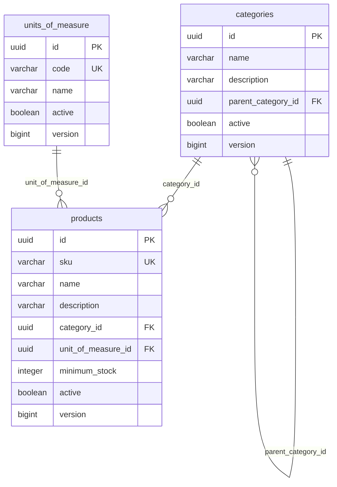
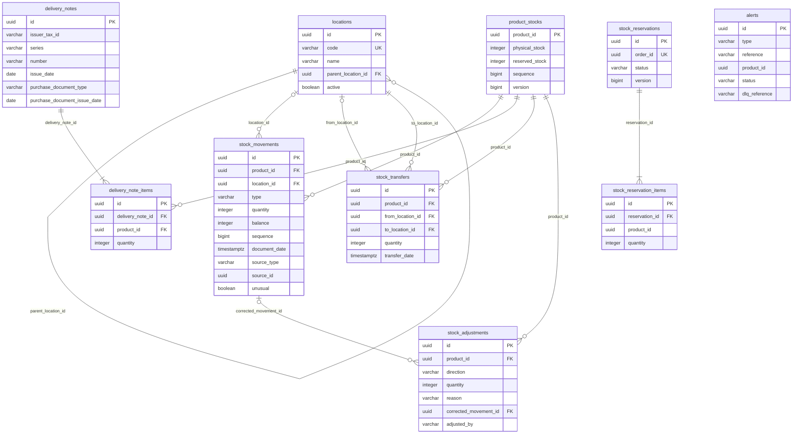
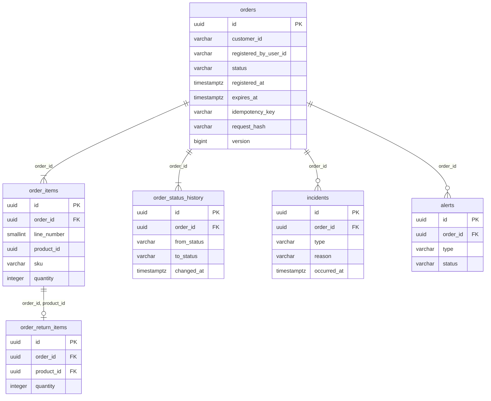

# Modelo de Datos

Esquema físico de las bases de cada microservicio. Traduce los agregados de `docs/domain-model.md` a tablas de PostgreSQL y documentos de MongoDB. Ticket: KOAL-10.

* El modelo de dominio manda: este documento define **cómo** se guarda, no **qué** se guarda.
* Los contratos de `docs/api/` no dependen de este esquema. Una columna puede cambiar sin cambiar la API, y viceversa (ADR-0011, entidades de persistencia separadas).

## 1. Bases por servicio

| Servicio | Base | Esquema | Contenido |
|---|---|---|---|
| Catálogo | PostgreSQL | `catalog` | Productos, categorías y unidades de medida |
| Inventario (escritura) | PostgreSQL, con replicación lógica | `inventory` | Agregados de stock, `outbox`, `processed_events`, `shedlock` |
| Inventario (lectura) | MongoDB | — | Modelos de lectura y log de idempotencia del proyector (ADR-0007) |
| Órdenes | PostgreSQL, con replicación lógica | `orders` | Pedidos, incidencias, alertas, `outbox`, `processed_events`, `shedlock` |
| Notificaciones | PostgreSQL | `notifications` | Registro de notificaciones |

Una base y un usuario por servicio (ADR-0003). Ningún servicio lee la base de otro.

## 2. Convenciones de PostgreSQL

### 2.1 Nombres

* **Tablas y columnas** en inglés y `snake_case`, con los términos de `docs/glosario.md`: `delivery_notes`, `physical_stock`.
* **Tablas en plural**: `products`, `stock_movements`, `order_items`. Las tablas técnicas de terceros conservan su nombre: `shedlock`, `flyway_schema_history`.
* **Esquema propio por servicio**, con el nombre del servicio, en vez de `public`. Así la configuración de Debezium y de Flyway lo nombra explícitamente (`inventory.outbox`).
* **Restricciones e índices con nombre explícito**, para que los errores y las migraciones sean legibles:

| Objeto | Formato | Ejemplo |
|---|---|---|
| Clave primaria | `pk_<tabla>` | `pk_orders` |
| Clave foránea | `fk_<tabla>_<columna>` | `fk_order_items_order_id` |
| Única | `uq_<tabla>_<columnas>` | `uq_products_sku` |
| Check | `ck_<tabla>_<columna>` | `ck_stock_movements_type` |
| Índice | `ix_<tabla>_<columnas>` | `ix_stock_movements_product_id_created_at` |

### 2.2 Tipos

| Dato del dominio | Tipo en PostgreSQL | Notas |
|---|---|---|
| Identificadores | `uuid` | UUIDv7, generado por la aplicación (2.3). |
| `Instant` | `timestamptz` | Siempre en UTC. |
| `LocalDate` | `date` | |
| `Quantity` | `integer` | Entera (domain-model, decisión 2026-11-07). `CHECK (> 0)` o `CHECK (>= 0)` según el campo. |
| Texto con límite | `varchar(n)` | El mismo `maxLength` del contrato OpenAPI. |
| Texto libre (motivos, descripciones) | `varchar(n)` con un límite amplio | Nunca sin límite: protege la base de entradas desmedidas. |
| `boolean` | `boolean` | |
| Enumeraciones | `varchar(n)` + `CHECK` | 2.4. |
| Contador de versión | `bigint` | 2.5. |
| JSON | `jsonb` | Solo en `outbox.payload`. Los datos de negocio no usan JSON (2.7). |

### 2.3 Identificadores

* **UUIDv7 generado por la aplicación**, en el dominio, antes de guardar (decidido 2026-11-14).
  * El id existe antes del `INSERT`, así el agregado, su evento del outbox y el header `Location` se arman en un solo paso.
  * UUIDv7 es ordenado por tiempo: los índices crecen al final y no se fragmentan, lo que importa en tablas grandes como `stock_movements` y `outbox`.
* La base **no** genera ids: las columnas `id` no tienen valor por defecto.
* La librería que genera UUIDv7 se elige al implementar el primer servicio.
* Las tablas hijas sin identidad propia en el dominio, como `order_status_history`, usan también un `id` UUIDv7, para no depender de claves compuestas en R2DBC.

### 2.4 Enumeraciones

* Se guardan como `varchar` con un `CHECK` que lista los valores: `CHECK (type IN ('INBOUND', 'OUTBOUND', ...))`.
* **No se usa el tipo `enum` de PostgreSQL**. Ampliar un `varchar` con `CHECK` es solo reemplazar el `CHECK` en una migración. Eso importa porque `MovementType` debe poder sumar `WRITE_OFF` (domain-model, Inventario), y R2DBC mapea un `varchar` sin conversores propios.
* Los valores son los mismos del dominio y de la API: mayúsculas con guion bajo.

### 2.5 Bloqueo optimista

* Todo agregado que cambia después de creado tiene `version bigint NOT NULL`, mapeado con `@Version` de Spring Data R2DBC.
* Un `UPDATE` que no encuentra la versión esperada falla, y la API responde `409` (`docs/api/README.md`, Errores).
* Los agregados inmutables, como `StockMovement`, no llevan `version`.

### 2.6 Borrado lógico y auditoría

* **Nada de negocio se borra físicamente.** Los maestros se desactivan con `active boolean NOT NULL`. Solo se purgan las tablas técnicas (`outbox`, `processed_events`), según la sección 3.
* **`created_at timestamptz NOT NULL`** en todas las tablas.
* **`updated_at timestamptz NOT NULL`** en las tablas que cambian. Lo asigna la aplicación con el `Clock` del dominio, no un trigger, para que los tests controlen la hora.
* **Quién hizo algo se guarda solo donde el dominio lo pide**, como columna del agregado: `registered_by` del pedido, el autor de un ajuste, quién reconoce o resuelve una alerta. Se guarda el `sub` del token. No hay columnas `created_by` y `updated_by` genéricas.

### 2.7 Value objects y colecciones

Decidido el 2026-11-14 (opción A).

* **Un value object va en columnas de la tabla de su agregado**, con el nombre del value object como prefijo: `contact_email`, `contact_phone`, `shipping_address_line`, `purchase_document_type`.
* **Una colección va en una tabla hija** con FK a su agregado: `order_items`, `order_status_history`.
* Un value object opcional deja sus columnas en `NULL`. Un `CHECK` garantiza que vengan completas o vacías, según las reglas del value object.
* No se usa `jsonb` para datos de negocio. Así la base valida con `NOT NULL` y `CHECK`, y se puede filtrar por cualquier campo sin funciones de JSON.
* R2DBC no mapea relaciones (ADR-0011): el adaptador guarda y carga cada agregado con sus tablas hijas, en la misma transacción.

### 2.8 Claves foráneas

Decidido el 2026-11-14 (opción 1).

* **Hay FK de cada tabla hija a su agregado**, y también **entre agregados de un mismo servicio**: `products.category_id` → `categories`, `stock_movements.location_id` → `locations`, `incidents.order_id` → `orders`.
* **Nunca hay FK entre servicios.** Un `product_id` en Inventario u Órdenes es solo un `uuid` sin FK, y un `customer_id` es el `sub` del token, sin FK (ADR-0003).
* **Las FK no tienen `ON DELETE CASCADE`.** Como nada se borra físicamente, un borrado accidental debe fallar.
* **Toda columna con FK tiene índice.** PostgreSQL no lo crea solo, y hace falta para consultar y para validar la FK.
* **Excepción: el origen de un `StockMovement`** (`source_type` + `source_id`) apunta a tablas distintas según el tipo (guía, pedido, traslado o ajuste), así que no tiene FK. Un `CHECK` valida `source_type` y el dominio valida el resto.

### 2.9 Índices

* Además de las FK, se indexa solo lo que una consulta conocida necesita: los filtros de los contratos OpenAPI y las búsquedas de los consumidores y jobs.
* Cada índice se justifica en la sección de su servicio con la consulta que lo usa.

## 3. Tablas técnicas

Son iguales en todos los servicios que las usan.

### 3.1 `outbox`

En Inventario (escritura) y Órdenes (ADR-0005, ADR-0006). Debezium la lee del WAL; el código solo inserta.

```sql
CREATE TABLE outbox (
    id              uuid         NOT NULL,  -- eventId del envelope
    aggregate_type  varchar(64)  NOT NULL,  -- elige el topic
    aggregate_id    uuid         NOT NULL,
    event_type      varchar(64)  NOT NULL,  -- eventType del envelope
    event_key       varchar(64)  NOT NULL,  -- clave del mensaje en Kafka (ADR-0008)
    payload         jsonb        NOT NULL,  -- envelope completo (ADR-0024)
    traceparent     varchar(55),            -- header W3C (ADR-0014)
    created_at      timestamptz  NOT NULL,
    CONSTRAINT pk_outbox PRIMARY KEY (id)
);
CREATE INDEX ix_outbox_created_at ON outbox (created_at);  -- purga
```

* **`event_key`** es `productId` en los eventos de stock y `orderId` en los de pedido y reserva (ADR-0008, ADR-0024). Un evento sin `productId` usa el id de su agregado.
* **El Outbox Event Router se configura con estos nombres**, porque no son sus valores por defecto: `table.field.event.id=id`, `table.field.event.key=event_key`, `table.field.event.type=event_type`, `table.field.event.payload=payload`, `route.by.field=aggregate_type` y `traceparent` como header (`table.fields.additional.placement`).
* Con `payload` en `jsonb`, el conector debe publicar el JSON tal cual y no como texto escapado. La opción exacta del conector se verifica al implementar Inventario.
* **Purga**: un job con ShedLock borra las filas con más de 7 días, configurable (ADR-0006).
* Cambiar esta tabla afecta al conector: esos cambios se coordinan con su configuración (ADR-0020).

### 3.2 `processed_events`

En Inventario (escritura) y Órdenes. Hace idempotentes a sus consumidores de Kafka (ADR-0005). Decidido el 2026-11-14 (opción 1).

```sql
CREATE TABLE processed_events (
    event_id      uuid         NOT NULL,  -- eventId del envelope
    consumer      varchar(64)  NOT NULL,  -- nombre del consumidor
    processed_at  timestamptz  NOT NULL,
    CONSTRAINT pk_processed_events PRIMARY KEY (event_id, consumer)
);
CREATE INDEX ix_processed_events_processed_at ON processed_events (processed_at);  -- purga
```

* **Cada consumidor inserta su fila en la misma transacción que el cambio.** Si el evento ya estaba, la inserción choca con la clave primaria y el evento se descarta sin cambiar nada.
* **`consumer`** distingue a dos consumidores del mismo servicio que procesan el mismo evento. Usa un nombre estable, como `inventory.order-events`.
* **La validación de estado del dominio se mantiene** (domain-model, Órdenes; `StockReservation` única por `orderId`). Las dos protecciones se complementan.
* **Purga**: el mismo job del outbox borra las filas con más de 7 días. Kafka no reentrega un evento tan viejo, salvo un reproceso manual de la DLQ, y en ese caso protege la validación de estado.
* El proyector de MongoDB (ADR-0007) y Notificaciones (`(eventId, channel)` único) tienen su propio mecanismo y no usan esta tabla.

### 3.3 `shedlock`

En Inventario (escritura) y Órdenes (ADR-0012). Usa el esquema que documenta ShedLock, sin cambios:

```sql
CREATE TABLE shedlock (
    name        varchar(64)   NOT NULL,
    lock_until  timestamp(3)  NOT NULL,
    locked_at   timestamp(3)  NOT NULL,
    locked_by   varchar(255)  NOT NULL,
    CONSTRAINT pk_shedlock PRIMARY KEY (name)
);
```

* Es la única excepción a `timestamptz` y a las tablas en plural: la define ShedLock. Se configura para usar la hora de la base (`usingDbTime`), así las instancias no dependen de sus relojes.

## 4. Migraciones (Flyway)

* **Archivos en `src/main/resources/db/migration`** del módulo de cada servicio (ADR-0018, ADR-0020).
* **Nombre `V<n>__<descripcion>.sql`**, con numeración simple por servicio y descripción en inglés y `snake_case`: `V1__create_products.sql`, `V2__create_outbox.sql`.
* **Una migración aplicada no se edita**; un cambio es una migración nueva y solo se avanza (ADR-0020).
* **Cada migración es compatible con la versión anterior del servicio**: primero se agrega (columna opcional, tabla nueva), después se usa, y lo que sobra se quita en una versión posterior.
* Flyway crea el esquema del servicio y guarda su historial en `flyway_schema_history`, dentro de ese esquema.

## 5. Convenciones de MongoDB

Solo en la lectura de Inventario (ADR-0007). No tiene migraciones: los documentos se regeneran desde la escritura (ADR-0020).

* **Colecciones en inglés, `camelCase` y plural**: `kardexEntries`, `productStockViews`, `activeAlertViews`.
* **Campos en `camelCase`**, con los mismos nombres de la API.
* **`_id` es el id natural**: el id del movimiento en `KardexEntry` y el `productId` en `ProductStockView` (ADR-0007, ADR-0025). Se guarda como UUID binario estándar (subtipo 4).
* **Todo va anidado en el documento**: el desglose por ubicación es una lista dentro de `ProductStockView`. Ningún modelo de lectura necesita uniones.
* **Fechas como `Date` de BSON**, en UTC.
* **Los índices se crean al arrancar el proyector**, desde el código, porque no hay migraciones. Cada uno se justifica con su consulta.

## 6. Catálogo

Esquema `catalog`. Tres agregados independientes, cada uno en su tabla (domain-model, Catálogo). No publica ni consume eventos y no tiene jobs, así que no lleva `outbox`, `processed_events` ni `shedlock`.



Las columnas `created_at` y `updated_at` están en todas las tablas y se omiten del diagrama.

### 6.1 `units_of_measure`

```sql
CREATE TABLE units_of_measure (
    id          uuid         NOT NULL,
    code        varchar(10)  NOT NULL,
    name        varchar(50)  NOT NULL,
    active      boolean      NOT NULL,
    version     bigint       NOT NULL,
    created_at  timestamptz  NOT NULL,
    updated_at  timestamptz  NOT NULL,
    CONSTRAINT pk_units_of_measure PRIMARY KEY (id),
    CONSTRAINT uq_units_of_measure_code UNIQUE (code),
    CONSTRAINT ck_units_of_measure_code CHECK (code ~ '^[A-Z0-9]+$'),
    CONSTRAINT ck_units_of_measure_name CHECK (btrim(name) <> '')
);
```

* **`code` es único** (`UNIT_OF_MEASURE_CODE_ALREADY_EXISTS`). El patrón del contrato ya exige mayúsculas, así que no hace falta comparar con `lower()`.
* El listado no se pagina y se ordena por `code`.

### 6.2 `categories`

```sql
CREATE TABLE categories (
    id                  uuid          NOT NULL,
    name                varchar(100)  NOT NULL,
    description         varchar(500),
    parent_category_id  uuid,
    active              boolean       NOT NULL,
    version             bigint        NOT NULL,
    created_at          timestamptz   NOT NULL,
    updated_at          timestamptz   NOT NULL,
    CONSTRAINT pk_categories PRIMARY KEY (id),
    CONSTRAINT fk_categories_parent_category_id
        FOREIGN KEY (parent_category_id) REFERENCES categories (id),
    CONSTRAINT ck_categories_name CHECK (btrim(name) <> ''),
    CONSTRAINT ck_categories_parent_category_id CHECK (parent_category_id <> id)
);

CREATE UNIQUE INDEX uq_categories_parent_category_id_name
    ON categories (COALESCE(parent_category_id, '00000000-0000-0000-0000-000000000000'), lower(name));
CREATE INDEX ix_categories_parent_category_id ON categories (parent_category_id);
```

* **Nombre único entre hermanas, sin distinguir mayúsculas** (decidido 2026-11-14, `CATEGORY_NAME_ALREADY_EXISTS`). Las categorías raíz tienen `parent_category_id` en `NULL`, y PostgreSQL considera distintos dos `NULL` en un índice único. Por eso el índice reemplaza `NULL` por un UUID fijo: así también las raíces son hermanas entre sí. Esto funciona en cualquier versión de PostgreSQL; desde la 15 se podría usar `NULLS NOT DISTINCT`.
* **La base solo impide que una categoría sea su propio padre.** Un ciclo más largo (A → B → A) lo valida el dominio antes de guardar, recorriendo los ancestros con una consulta recursiva (`CATEGORY_HIERARCHY_CYCLE`).
* **`ix_categories_parent_category_id`** sirve a la FK y al filtro `?parentCategoryId=`. El índice único no sirve para eso, porque empieza por una expresión.
* El listado no se pagina y se ordena por `name`.

### 6.3 `products`

```sql
CREATE TABLE products (
    id                  uuid           NOT NULL,
    sku                 varchar(64)    NOT NULL,
    name                varchar(200)   NOT NULL,
    description         varchar(1000),
    category_id         uuid           NOT NULL,
    unit_of_measure_id  uuid           NOT NULL,
    minimum_stock       integer        NOT NULL,
    active              boolean        NOT NULL,
    version             bigint         NOT NULL,
    created_at          timestamptz    NOT NULL,
    updated_at          timestamptz    NOT NULL,
    CONSTRAINT pk_products PRIMARY KEY (id),
    CONSTRAINT fk_products_category_id
        FOREIGN KEY (category_id) REFERENCES categories (id),
    CONSTRAINT fk_products_unit_of_measure_id
        FOREIGN KEY (unit_of_measure_id) REFERENCES units_of_measure (id),
    CONSTRAINT ck_products_sku CHECK (sku ~ '^[A-Za-z0-9._-]+$'),
    CONSTRAINT ck_products_name CHECK (btrim(name) <> ''),
    CONSTRAINT ck_products_minimum_stock CHECK (minimum_stock >= 0)
);

CREATE UNIQUE INDEX uq_products_sku ON products (lower(sku));
CREATE INDEX ix_products_category_id ON products (category_id);
CREATE INDEX ix_products_unit_of_measure_id ON products (unit_of_measure_id);
CREATE INDEX ix_products_name_id ON products (name, id);
```

* **SKU único sin distinguir mayúsculas** (decidido 2026-11-14, `PRODUCT_SKU_ALREADY_EXISTS`). Se guarda tal como se registró; el índice compara con `lower(sku)`. El filtro `?sku=` consulta con `lower(sku) = lower(:sku)` y usa el mismo índice.
* **El SKU es inmutable** por regla del dominio: el `UPDATE` del adaptador no incluye la columna. La base no lo impide con un trigger.
* **Una categoría o unidad inactiva** se valida en el dominio (`PRODUCT_INVALID_REFERENCE`). La FK solo garantiza que exista, porque un producto puede conservar una que se desactivó después (domain-model, decisión 2026-11-07).
* **`ix_products_name_id`** da el orden estable del listado paginado: por `name` y, si hay empate, por `id`.
* **La búsqueda `?q=`** usa `sku ILIKE '%texto%' OR name ILIKE '%texto%'`, sin índice especial: con los 1 000 productos del entorno de referencia, recorrer la tabla es instantáneo. Si el catálogo crece mucho, se agrega un índice trigram (`pg_trgm`) en una migración, sin cambiar la API.
* **`?ids=`** usa la clave primaria (`id = ANY(:ids)`), hasta 100 ids.
* `?categoryId=` usa `ix_products_category_id`. `?active=` no lleva índice, porque casi todos los productos están activos y el índice no filtraría casi nada.

### 6.4 Migraciones

| Versión | Archivo | Contenido |
|---|---|---|
| 1 | `V1__create_units_of_measure.sql` | 6.1 |
| 2 | `V2__create_categories.sql` | 6.2 |
| 3 | `V3__create_products.sql` | 6.3, después de sus dos referencias |

No hay datos iniciales: el administrador crea las unidades y las categorías por API.

## 7. Inventario (escritura)

Esquema `inventory`. Es la fuente de verdad del stock y del kardex (ADR-0004). Todo lo que alimenta la lectura sale por el `outbox` (3.1). Los consumidores de eventos de Órdenes usan `processed_events` (3.2), y la purga usa `shedlock` (3.3).



El diagrama resume las columnas; el detalle está en el SQL de cada tabla. `outbox`, `processed_events` y `shedlock` son las de la sección 3 y no se repiten.

**Referencias a `product_stocks`**: dentro de Inventario, el producto es el agregado `ProductStock`, así que las tablas que exigen que el producto tenga stock registrado tienen FK a `product_stocks (product_id)` (2.8). Las reservas y las alertas no la tienen, porque pueden referirse a un producto que todavía no tiene stock (7.7, 7.8). Ninguna tabla tiene FK a Catálogo.

### 7.1 `locations`

```sql
CREATE TABLE locations (
    id                  uuid          NOT NULL,
    code                varchar(30)   NOT NULL,
    name                varchar(100)  NOT NULL,
    parent_location_id  uuid,
    active              boolean       NOT NULL,
    version             bigint        NOT NULL,
    created_at          timestamptz   NOT NULL,
    updated_at          timestamptz   NOT NULL,
    CONSTRAINT pk_locations PRIMARY KEY (id),
    CONSTRAINT fk_locations_parent_location_id
        FOREIGN KEY (parent_location_id) REFERENCES locations (id),
    CONSTRAINT uq_locations_code UNIQUE (code),
    CONSTRAINT ck_locations_code CHECK (code ~ '^[A-Z0-9-]+$'),
    CONSTRAINT ck_locations_name CHECK (btrim(name) <> ''),
    CONSTRAINT ck_locations_parent_location_id CHECK (parent_location_id <> id)
);

CREATE INDEX ix_locations_parent_location_id ON locations (parent_location_id);
```

* Igual que `categories` (6.2): la base impide que una ubicación sea su propio padre, y el dominio valida los ciclos más largos (`LOCATION_HIERARCHY_CYCLE`).
* `code` es único (`LOCATION_CODE_ALREADY_EXISTS`). El patrón ya exige mayúsculas, así que no hace falta `lower()`.

### 7.2 `product_stocks`

```sql
CREATE TABLE product_stocks (
    product_id      uuid         NOT NULL,
    physical_stock  integer      NOT NULL,
    reserved_stock  integer      NOT NULL,
    sequence        bigint       NOT NULL,
    version         bigint       NOT NULL,
    created_at      timestamptz  NOT NULL,
    updated_at      timestamptz  NOT NULL,
    CONSTRAINT pk_product_stocks PRIMARY KEY (product_id),
    CONSTRAINT ck_product_stocks_physical_stock CHECK (physical_stock >= 0),
    CONSTRAINT ck_product_stocks_reserved_stock
        CHECK (reserved_stock >= 0 AND reserved_stock <= physical_stock),
    CONSTRAINT ck_product_stocks_sequence CHECK (sequence >= 0)
);
```

* **La clave primaria es `product_id`**, el id del producto en Catálogo: hay una fila por producto y el agregado no tiene id propio (domain-model).
* **La fila se crea con el primer ingreso**, en la misma transacción que la guía. Un traslado o un ajuste de un producto sin fila responde `PRODUCT_STOCK_NOT_FOUND`. Una reserva de un producto sin fila cuenta su stock como 0.
* **El invariante del disponible está también en la base**: `reserved_stock <= physical_stock`. Si un error del dominio lo rompiera, la transacción falla en vez de guardar un disponible negativo.
* **`version` y `sequence` son columnas distintas** (ADR-0025). `version` es el bloqueo optimista. `sequence` sube de 1 en 1 por cada evento de stock, también en los traslados, y nunca salta.
* `GET /stock` (solo productos con ingresos) lee de MongoDB, no de esta tabla.

### 7.3 `stock_movements`

El kardex. Solo se inserta; ninguna operación hace `UPDATE` ni `DELETE`.

```sql
CREATE TABLE stock_movements (
    id             uuid         NOT NULL,
    product_id     uuid         NOT NULL,
    location_id    uuid,
    type           varchar(20)  NOT NULL,
    quantity       integer      NOT NULL,
    balance        integer      NOT NULL,
    sequence       bigint       NOT NULL,
    document_date  timestamptz  NOT NULL,
    source_type    varchar(20)  NOT NULL,
    source_id      uuid         NOT NULL,
    unusual        boolean      NOT NULL,
    created_at     timestamptz  NOT NULL,
    CONSTRAINT pk_stock_movements PRIMARY KEY (id),
    CONSTRAINT fk_stock_movements_product_id
        FOREIGN KEY (product_id) REFERENCES product_stocks (product_id),
    CONSTRAINT fk_stock_movements_location_id
        FOREIGN KEY (location_id) REFERENCES locations (id),
    CONSTRAINT uq_stock_movements_product_id_sequence UNIQUE (product_id, sequence),
    CONSTRAINT ck_stock_movements_type CHECK (type IN (
        'INBOUND', 'OUTBOUND', 'RETURN', 'CANCELLATION',
        'TRANSFER_OUT', 'TRANSFER_IN', 'ADJUSTMENT_IN', 'ADJUSTMENT_OUT')),
    CONSTRAINT ck_stock_movements_source_type CHECK (
           (type = 'INBOUND' AND source_type = 'DELIVERY_NOTE')
        OR (type IN ('OUTBOUND', 'RETURN', 'CANCELLATION') AND source_type = 'ORDER')
        OR (type IN ('TRANSFER_OUT', 'TRANSFER_IN') AND source_type = 'STOCK_TRANSFER')
        OR (type IN ('ADJUSTMENT_IN', 'ADJUSTMENT_OUT') AND source_type = 'STOCK_ADJUSTMENT')),
    CONSTRAINT ck_stock_movements_quantity CHECK (quantity > 0),
    CONSTRAINT ck_stock_movements_balance CHECK (balance >= 0)
);

CREATE INDEX ix_stock_movements_location_id ON stock_movements (location_id);
```

* **`balance`** es el stock real del producto después del movimiento, el saldo acumulado del kardex. En un traslado no cambia.
* **`sequence`** es el número de cambio del producto que llevó su `StockMovementRecorded` (ADR-0025).
* **Por qué se guardan `balance` y `sequence`**: los calcula la escritura al crear el movimiento, y ya viajan en el evento. Guardarlos permite que `RebuildProductProjection` regenere el kardex en el mismo orden y con los mismos saldos, sin recalcular nada.
* **`uq_stock_movements_product_id_sequence`** impide dos movimientos con el mismo número de cambio, y es el índice de la reconstrucción y del desglose por ubicación: los movimientos de un producto en orden de `sequence`.
* **El origen polimórfico no tiene FK** (2.8). En cambio, `ck_stock_movements_source_type` impide combinaciones absurdas, como un `INBOUND` que venga de un pedido.
* **`document_date`** de un ingreso es el inicio del `issueDate` del documento de compra, en la zona horaria del negocio (domain-model, decidido 2026-11-14). La zona se configura en `inventory.business-time-zone`, por defecto `America/Lima`. **`unusual`** se calcula con ese valor y se guarda; nunca se recalcula.
* **Ampliar `type`** (por ejemplo, con `WRITE_OFF`) es reemplazar los dos `CHECK` en una migración (2.4).
* `GET /products/{id}/kardex` lee de MongoDB, no de esta tabla.

### 7.4 `delivery_notes` y `delivery_note_items`

```sql
CREATE TABLE delivery_notes (
    id                            uuid         NOT NULL,
    issuer_tax_id                 varchar(11)  NOT NULL,
    series                        varchar(20)  NOT NULL,
    number                        varchar(20)  NOT NULL,
    issue_date                    date         NOT NULL,
    purchase_document_type        varchar(20)  NOT NULL,
    purchase_document_series      varchar(20),
    purchase_document_number      varchar(20)  NOT NULL,
    purchase_document_issue_date  date         NOT NULL,
    registered_at                 timestamptz  NOT NULL,
    CONSTRAINT pk_delivery_notes PRIMARY KEY (id),
    CONSTRAINT ck_delivery_notes_issuer_tax_id CHECK (issuer_tax_id ~ '^[0-9]{11}$'),
    CONSTRAINT ck_delivery_notes_purchase_document_type
        CHECK (purchase_document_type IN ('INVOICE', 'PURCHASE_ORDER'))
);

CREATE UNIQUE INDEX uq_delivery_notes_issuer_tax_id_series_number
    ON delivery_notes (issuer_tax_id, lower(series), lower(number));
CREATE INDEX ix_delivery_notes_issue_date ON delivery_notes (issue_date);

CREATE TABLE delivery_note_items (
    id                uuid     NOT NULL,
    delivery_note_id  uuid     NOT NULL,
    product_id        uuid     NOT NULL,
    quantity          integer  NOT NULL,
    CONSTRAINT pk_delivery_note_items PRIMARY KEY (id),
    CONSTRAINT fk_delivery_note_items_delivery_note_id
        FOREIGN KEY (delivery_note_id) REFERENCES delivery_notes (id),
    CONSTRAINT fk_delivery_note_items_product_id
        FOREIGN KEY (product_id) REFERENCES product_stocks (product_id),
    CONSTRAINT uq_delivery_note_items_delivery_note_id_product_id
        UNIQUE (delivery_note_id, product_id),
    CONSTRAINT ck_delivery_note_items_quantity CHECK (quantity > 0)
);

CREATE INDEX ix_delivery_note_items_product_id ON delivery_note_items (product_id);
```

* **La guía es única por RUC del emisor, serie y número, sin distinguir mayúsculas** (decidido 2026-11-14, `DELIVERY_NOTE_ALREADY_EXISTS`). Esto impide registrar dos veces la misma guía, que duplicaría el stock.
* **El documento de compra va en columnas con prefijo** `purchase_document_` (2.7). Su serie es opcional, porque una orden de compra puede no tenerla.
* **La guía es inmutable**, así que no tiene `version` ni `updated_at`. `registered_at` es su fecha de creación y cumple la función de `created_at`.
* **`uq_delivery_note_items_delivery_note_id_product_id`** impide repetir un producto en la guía.
* **El orden de inserción importa por las FK**: primero se crea o actualiza la fila de `product_stocks`, después la guía y sus ítems, y al final los movimientos.
* `GET /delivery-notes` filtra por fechas con `ix_delivery_notes_issue_date` y por producto con `ix_delivery_note_items_product_id`. Se ordena por `issue_date` descendente y, si hay empate, por `id`.

### 7.5 `stock_transfers`

```sql
CREATE TABLE stock_transfers (
    id                uuid         NOT NULL,
    product_id        uuid         NOT NULL,
    from_location_id  uuid,
    to_location_id    uuid         NOT NULL,
    quantity          integer      NOT NULL,
    transfer_date     timestamptz  NOT NULL,
    created_at        timestamptz  NOT NULL,
    CONSTRAINT pk_stock_transfers PRIMARY KEY (id),
    CONSTRAINT fk_stock_transfers_product_id
        FOREIGN KEY (product_id) REFERENCES product_stocks (product_id),
    CONSTRAINT fk_stock_transfers_from_location_id
        FOREIGN KEY (from_location_id) REFERENCES locations (id),
    CONSTRAINT fk_stock_transfers_to_location_id
        FOREIGN KEY (to_location_id) REFERENCES locations (id),
    CONSTRAINT ck_stock_transfers_locations CHECK (from_location_id <> to_location_id),
    CONSTRAINT ck_stock_transfers_quantity CHECK (quantity > 0)
);

CREATE INDEX ix_stock_transfers_product_id ON stock_transfers (product_id);
CREATE INDEX ix_stock_transfers_from_location_id ON stock_transfers (from_location_id);
CREATE INDEX ix_stock_transfers_to_location_id ON stock_transfers (to_location_id);
```

* **`from_location_id` vacío** es la mercadería sin ubicación: asignar ubicación a un ingreso es un traslado desde "sin ubicación" (domain-model). Con `from_location_id` en `NULL`, el `CHECK` de ubicaciones distintas no aplica, que es lo correcto.
* **Que las ubicaciones estén activas** lo valida el dominio (`STOCK_TRANSFER_INVALID_LOCATION`). La FK solo garantiza que existan.
* Es inmutable: sin `version` ni `updated_at`. No hay listado de traslados (fuera de alcance, `docs/adr/README.md`); los índices sirven a las FK.

### 7.6 `stock_adjustments`

```sql
CREATE TABLE stock_adjustments (
    id                     uuid          NOT NULL,
    product_id             uuid          NOT NULL,
    direction              varchar(3)    NOT NULL,
    quantity               integer       NOT NULL,
    reason                 varchar(500)  NOT NULL,
    corrected_movement_id  uuid,
    adjusted_by            varchar(64)   NOT NULL,
    adjusted_at            timestamptz   NOT NULL,
    CONSTRAINT pk_stock_adjustments PRIMARY KEY (id),
    CONSTRAINT fk_stock_adjustments_product_id
        FOREIGN KEY (product_id) REFERENCES product_stocks (product_id),
    CONSTRAINT fk_stock_adjustments_corrected_movement_id
        FOREIGN KEY (corrected_movement_id) REFERENCES stock_movements (id),
    CONSTRAINT ck_stock_adjustments_direction CHECK (direction IN ('IN', 'OUT')),
    CONSTRAINT ck_stock_adjustments_quantity CHECK (quantity > 0),
    CONSTRAINT ck_stock_adjustments_reason CHECK (btrim(reason) <> '')
);

CREATE INDEX ix_stock_adjustments_product_id_adjusted_at
    ON stock_adjustments (product_id, adjusted_at);
CREATE INDEX ix_stock_adjustments_corrected_movement_id
    ON stock_adjustments (corrected_movement_id);
CREATE INDEX ix_stock_adjustments_adjusted_at ON stock_adjustments (adjusted_at);
```

* **`adjusted_by`** es el `sub` del token del administrador (2.6).
* **`corrected_movement_id`** tiene FK a `stock_movements`, así un movimiento corregido inexistente falla también en la base (`STOCK_ADJUSTMENT_INVALID_MOVEMENT`). Que sea del mismo producto lo valida el dominio.
* Es inmutable, y `adjusted_at` cumple la función de `created_at`, como `registered_at` en la guía.
* `GET /stock-adjustments` filtra por producto con `ix_stock_adjustments_product_id_adjusted_at` y, sin filtro, ordena por `ix_stock_adjustments_adjusted_at`, de lo más reciente a lo más antiguo.

### 7.7 `stock_reservations` y `stock_reservation_items`

```sql
CREATE TABLE stock_reservations (
    id          uuid         NOT NULL,
    order_id    uuid         NOT NULL,
    status      varchar(10)  NOT NULL,
    version     bigint       NOT NULL,
    created_at  timestamptz  NOT NULL,
    updated_at  timestamptz  NOT NULL,
    CONSTRAINT pk_stock_reservations PRIMARY KEY (id),
    CONSTRAINT uq_stock_reservations_order_id UNIQUE (order_id),
    CONSTRAINT ck_stock_reservations_status
        CHECK (status IN ('PENDING', 'ACTIVE', 'RELEASED', 'CONSUMED'))
);

CREATE INDEX ix_stock_reservations_pending_created_at
    ON stock_reservations (created_at) WHERE status = 'PENDING';

CREATE TABLE stock_reservation_items (
    id              uuid     NOT NULL,
    reservation_id  uuid     NOT NULL,
    product_id      uuid     NOT NULL,
    quantity        integer  NOT NULL,
    CONSTRAINT pk_stock_reservation_items PRIMARY KEY (id),
    CONSTRAINT fk_stock_reservation_items_reservation_id
        FOREIGN KEY (reservation_id) REFERENCES stock_reservations (id),
    CONSTRAINT uq_stock_reservation_items_reservation_id_product_id
        UNIQUE (reservation_id, product_id),
    CONSTRAINT ck_stock_reservation_items_quantity CHECK (quantity > 0)
);

CREATE INDEX ix_stock_reservation_items_product_id ON stock_reservation_items (product_id);
```

* **`order_id` es único**: una reserva por pedido, que es la idempotencia natural de la saga (domain-model). Es un id de Órdenes, sin FK.
* **`stock_reservation_items.product_id` no tiene FK a `product_stocks`**: un pedido puede incluir un producto que nunca tuvo ingresos, y su reserva queda `PENDING`.
* **Reintento FIFO** (`RetryPendingReservations`): tras un ingreso del producto X, busca las reservas `PENDING` que incluyen X, ordenadas por `created_at`. Usa `ix_stock_reservation_items_product_id` para encontrarlas y el índice parcial `ix_stock_reservations_pending_created_at` para ordenarlas. El índice parcial solo guarda las reservas pendientes, que son pocas.
* Los ítems no cambian después de crear la reserva; solo cambia su `status`, con bloqueo optimista.

### 7.8 `alerts`

```sql
CREATE TABLE alerts (
    id               uuid          NOT NULL,
    type             varchar(20)   NOT NULL,
    reference        varchar(64)   NOT NULL,
    product_id       uuid,
    message          varchar(500)  NOT NULL,
    status           varchar(15)   NOT NULL,
    dlq_reference    varchar(300),
    acknowledged_at  timestamptz,
    acknowledged_by  varchar(64),
    resolved_at      timestamptz,
    resolved_by      varchar(64),
    version          bigint        NOT NULL,
    created_at       timestamptz   NOT NULL,
    updated_at       timestamptz   NOT NULL,
    CONSTRAINT pk_alerts PRIMARY KEY (id),
    CONSTRAINT ck_alerts_type CHECK (type IN (
        'MINIMUM_STOCK', 'UNUSUAL_MOVEMENT', 'INSUFFICIENT_STOCK',
        'SYNC_FAILURE', 'STOCK_ADJUSTMENT')),
    CONSTRAINT ck_alerts_status CHECK (status IN ('ACTIVE', 'ACKNOWLEDGED', 'RESOLVED')),
    CONSTRAINT ck_alerts_product_id CHECK (type <> 'MINIMUM_STOCK' OR product_id IS NOT NULL),
    CONSTRAINT ck_alerts_dlq_reference CHECK (type = 'SYNC_FAILURE' OR dlq_reference IS NULL),
    CONSTRAINT ck_alerts_resolved_at CHECK ((status = 'RESOLVED') = (resolved_at IS NOT NULL))
);

CREATE UNIQUE INDEX uq_alerts_minimum_stock_product_id
    ON alerts (product_id) WHERE type = 'MINIMUM_STOCK' AND status <> 'RESOLVED';
CREATE INDEX ix_alerts_sync_failure_unresolved_created_at
    ON alerts (created_at) WHERE type = 'SYNC_FAILURE' AND status <> 'RESOLVED';
```

* **`reference`** es el campo del contrato: `productId`, `stockMovementId` u `orderId`, según el tipo.
* **`product_id`** se llena siempre que la alerta tiene un producto, también cuando `reference` apunta a otra cosa. No tiene FK, porque una alerta puede referirse a un producto sin stock registrado.
* **Una sola alerta de stock mínimo sin resolver por producto** (decidido 2026-11-14): lo garantiza el índice único parcial `uq_alerts_minimum_stock_product_id`. `ACKNOWLEDGED` también cuenta. El mismo índice sirve para encontrarla cuando el stock se recupera y se resuelve sola.
* **Quién y cuándo**: `acknowledged_by`/`acknowledged_at` y `resolved_by`/`resolved_at` (2.6). Cuando la resuelve el sistema, `resolved_by` queda vacío. `resolved_at` detiene el reloj del escalamiento (ADR-0009).
* **`dlq_reference`** solo existe en `SYNC_FAILURE`: topic, partición y offset del evento en la DLQ, para reprocesarlo (ADR-0009). La alerta la crea el proyector cuando un evento termina en la DLQ, aquí y con su `AlertRaised` en el outbox, en la misma transacción.
* **Métrica de escalamiento** (ADR-0009): la antigüedad de la `SYNC_FAILURE` sin resolver más antigua, con `ix_alerts_sync_failure_unresolved_created_at`.
* `GET /alerts` lee de MongoDB (`ActiveAlertView`), no de esta tabla.

### 7.9 Replicación lógica

* La base corre con `wal_level=logical` y un usuario con permiso de replicación para Debezium (ADR-0003, ADR-0006).
* **La publicación incluye solo `outbox`**, así Debezium no decodifica los cambios de las demás tablas. La crea la migración de 7.10, y el conector la usa sin crear la suya (`publication.autocreate.mode=disabled`).

### 7.10 Migraciones

| Versión | Archivo | Contenido |
|---|---|---|
| 1 | `V1__create_locations.sql` | 7.1 |
| 2 | `V2__create_product_stocks.sql` | 7.2 |
| 3 | `V3__create_stock_movements.sql` | 7.3 |
| 4 | `V4__create_delivery_notes.sql` | 7.4 |
| 5 | `V5__create_stock_transfers.sql` | 7.5 |
| 6 | `V6__create_stock_adjustments.sql` | 7.6, después de `stock_movements` |
| 7 | `V7__create_stock_reservations.sql` | 7.7 |
| 8 | `V8__create_alerts.sql` | 7.8 |
| 9 | `V9__create_outbox.sql` | 3.1, más la publicación de 7.9 |
| 10 | `V10__create_processed_events.sql` | 3.2 |
| 11 | `V11__create_shedlock.sql` | 3.3 |

Crear la publicación exige ser dueño de la tabla, así que corre con el mismo usuario de Flyway. Si en un entorno la crea un DBA, esa parte sale de la migración. Se verifica al implementar Inventario.

## 8. Inventario (lectura)

Base MongoDB de lectura de Inventario (sección 1), con las convenciones de la sección 5. Solo la escribe el proyector, que consume `inventory.internal.events` (ADR-0008), y solo la lee la API de consultas. Corre sin replica set, así que no hay transacciones de varios documentos: cada evento se puede aplicar dos veces sin dañar el resultado (ADR-0007, ADR-0025). La fuente de verdad sigue siendo la escritura (sección 7), y cualquier documento se puede regenerar desde ella (8.6).

| Colección | Modelo | Alimentada por | Consulta |
|---|---|---|---|
| `productStockViews` | `ProductStockView` | `ProductStockChanged`, `StockMovementRecorded` | `GET /stock`, `GET /products/{id}/stock`, `outOfSync` del kardex |
| `kardexEntries` | `KardexEntry` | `StockMovementRecorded` | `GET /products/{id}/kardex` |
| `activeAlertViews` | `ActiveAlertView` | `AlertRaised`, `AlertStatusChanged` | `GET /alerts` |
| `processedEvents` | Log de idempotencia | Todos | Solo el proyector |

### 8.1 `productStockViews`

```javascript
{
  _id: UUID("3fa85f64-5717-4562-b3fc-2c963f66afa6"), // productId
  physicalStock: NumberLong(62),
  reservedStock: NumberLong(2),
  availableStock: NumberLong(60),
  locations: [
    { locationId: null, quantity: NumberLong(-10) },
    { locationId: UUID("5e1f3c52-6f1e-4c7b-9a64-1d2c3e4f5a6b"), quantity: NumberLong(72) }
  ],
  lastSequence: NumberLong(42),
  outOfSync: false,
  outOfSyncSince: null,
  updatedAt: ISODate("2026-11-07T15:30:01Z")
}

db.productStockViews.createIndex({ availableStock: 1, _id: 1 })
```

* **Un documento por producto**, creado con el primer evento de stock, que siempre es el de un ingreso. Por eso `GET /stock` solo muestra productos con algún ingreso.
* **`physicalStock` y `reservedStock`** se reemplazan con los valores absolutos de `ProductStockChanged`. **`availableStock`** se calcula al aplicarlo y se guarda, para filtrar `?availability=` con índice.
* **`locations`** se arma sumando y restando cada `StockMovementRecorded` en su ubicación, con signo según `type`. `locationId: null` es la mercadería sin ubicación.
* **El desglose puede tener cantidades negativas** (decidido 2026-11-15). Un `OUTBOUND` sale sin ubicación, y un traslado no valida la cantidad del origen (domain-model). Si se ingresan 50, se trasladan a A y sale un pedido de 10, queda A = 50 y "sin ubicación" = −10. La suma del desglose siempre es igual a `physicalStock`, y el negativo muestra que no se registró de dónde salió la mercadería. La API omite las ubicaciones en 0.
* **`lastSequence`** es el último número de cambio aplicado (ADR-0025). No sale en la API.
* **`outOfSync`** solo vive aquí. `GET /products/{id}/kardex` lo lee de este documento, no de cada `KardexEntry`. **`outOfSyncSince`** guarda el primer fallo: un fallo nuevo sobre un producto ya marcado no lo cambia.
* **`GET /stock` se ordena por `_id`** (decidido 2026-11-15). Como el `productId` es UUIDv7, equivale al orden de alta del producto en Catálogo. SKU y nombre no están en MongoDB, porque se consultan a Catálogo en cada llamada (inventory.yaml) y Catálogo no publica eventos (ADR-0004).
* **Índice `{ availableStock: 1, _id: 1 }`**: `OUT_OF_STOCK` es una igualdad y lo usa entero. `IN_STOCK` y `ALL` recorren `_id` en orden y filtran.

### 8.2 `kardexEntries`

```javascript
{
  _id: UUID("b23f3c52-6f1e-4c7b-9a64-1d2c3e4f5a6b"), // movementId
  productId: UUID("3fa85f64-5717-4562-b3fc-2c963f66afa6"),
  sequence: NumberLong(41),
  type: "INBOUND",
  quantity: NumberLong(50),
  balance: NumberLong(62),
  locationId: null,
  documentDate: ISODate("2026-11-06T05:00:00Z"),
  createdAt: ISODate("2026-11-07T14:00:00Z"),
  source: { sourceType: "DELIVERY_NOTE", sourceId: UUID("c34f3c52-6f1e-4c7b-9a64-1d2c3e4f5a6b") },
  unusual: false
}

db.kardexEntries.createIndex({ productId: 1, sequence: 1 }, { unique: true })
db.kardexEntries.createIndex({ productId: 1, createdAt: 1 })
```

* **Una entrada por movimiento**, con el `_id` del movimiento: un duplicado lo rechaza MongoDB y se ignora (ADR-0007). Nunca se borra; es el kardex.
* **`balance`** viene calculado en el evento: el proyector no suma nada.
* **`productId` y `sequence`** no salen en cada entrada de la API, pero se necesitan para consultar y ordenar.
* **El rango de fechas filtra por `createdAt`** (decidido 2026-11-15), la fecha de registro. `fromDate` y `toDate` son días completos en `inventory.business-time-zone` (`America/Lima`), ambos inclusive: `createdAt >= inicio(fromDate)` y `createdAt < inicio(toDate + 1)`.
* **El orden es `sequence`**, el orden en que se calculó `balance`, así que los saldos se leen en secuencia. Una guía registrada con fecha atrasada no se mete entre movimientos anteriores: aparece cuando se registró, y `unusual` la señala.
* **Índices**: `{ productId, createdAt }` resuelve el rango, y el orden por `sequence` se hace sobre esas entradas. Con paginación, MongoDB solo guarda en memoria las de la página pedida y las anteriores. `{ productId, sequence }` es único: refuerza que no haya dos entradas con el mismo número de cambio y sirve para el orden.
* **El filtro `locationId`** se aplica sobre ese mismo rango, sin índice propio: es un producto y un rango de días. `balance` sigue siendo el del producto (inventory.yaml).

### 8.3 `activeAlertViews`

```javascript
{
  _id: UUID("3abf3c52-6f1e-4c7b-9a64-1d2c3e4f5a6b"), // alertId
  type: "MINIMUM_STOCK",
  reference: "3fa85f64-5717-4562-b3fc-2c963f66afa6",
  message: "Leche entera 1 L bajo el stock mínimo",
  status: "ACTIVE",
  createdAt: ISODate("2026-11-07T16:10:00Z")
}

db.activeAlertViews.createIndex({ createdAt: -1 })
```

* **Solo alertas `ACTIVE` y `ACKNOWLEDGED`**, con los campos de `Alert` del contrato.
* **`AlertRaised` inserta** el documento con el `alertId` como `_id`. **`AlertStatusChanged` cambia `status`**, y si es `RESOLVED`, **borra** el documento.
* **El orden lo garantiza Kafka**: los dos eventos usan el `alertId` como clave y caen en la misma partición (ADR-0008). Si se reprocesan, se aplican en el mismo orden y terminan igual.
* **`GET /alerts` se ordena de la más reciente a la más antigua**, con el índice `{ createdAt: -1 }`. Los filtros `type` y `status` no tienen índice propio: la colección solo guarda lo que está sin resolver y es pequeña.
* **El escalamiento de `SYNC_FAILURE` no lee esta colección** sino `alerts` (7.8), porque depende de la proyección que puede estar fallando (ADR-0009).

### 8.4 `processedEvents`

```javascript
{
  _id: UUID("a12f3c52-6f1e-4c7b-9a64-1d2c3e4f5a6b"), // eventId
  eventType: "StockMovementRecorded",
  processedAt: ISODate("2026-11-07T14:00:01Z")
}

db.processedEvents.createIndex({ processedAt: 1 }, { expireAfterSeconds: 604800 })
```

* **El log de idempotencia del proyector** (ADR-0007, `docs/README.md` 3.1). Se mantiene aunque `sequence` y los `_id` ya hacen que aplicar un evento dos veces no cause daño (decidido 2026-11-15). Cuesta una escritura por evento y deja la misma regla en todos los consumidores: cada uno tiene su log.
* **Se consulta antes de aplicar un evento y se escribe después.** Si el proyector cae en medio, el evento se reaplica sin daño.
* **No lleva `consumer`**: el proyector es el único consumidor de esta base. Es la diferencia con `processed_events` (3.2).
* **El índice TTL lo purga a los 7 días**, el mismo plazo que `processed_events`, sin job ni `shedlock`. Un evento más viejo que se reprocese desde la DLQ lo descartan igual `lastSequence` o el `_id`.

### 8.5 Cómo se aplica cada evento

Las reglas de 8.1 a 8.3, en el orden en que se ejecutan:

| Evento | Pasos |
|---|---|
| `StockMovementRecorded` | 1. Insertar el `KardexEntry`; si ya existe, seguir. 2. Actualizar el desglose de `productStockViews` y `lastSequence`, de forma condicional (abajo). |
| `ProductStockChanged` | Reemplazar `physicalStock`, `reservedStock` y `availableStock`, y fijar `lastSequence`, de forma condicional. |
| `AlertRaised` | Insertar en `activeAlertViews`; si ya existe, seguir. |
| `AlertStatusChanged` | Cambiar `status`, o borrar el documento si es `RESOLVED`. Si no existe, seguir. |

* **Primero el kardex y después la vista.** Si el proyector cae entre los dos, al reprocesar el evento el kardex rechaza el duplicado y la vista se actualiza. En el orden inverso, la vista ya tendría ese `sequence`, el evento se descartaría y la línea del kardex se perdería.
* **Actualización condicional**: una sola operación sobre el documento del producto, con filtro `lastSequence = sequence − 1`. Para el desglose son dos intentos, ambos con ese filtro: `$inc` sobre la ubicación si ya está en `locations`, o `$push` si no está. Si ninguno coincide, se lee el documento:
  * **No existe y `sequence` = 1**: se inserta.
  * **`lastSequence` ≥ `sequence`**: el evento ya se aplicó y se descarta.
  * **`lastSequence` < `sequence` − 1, o no existe y `sequence` > 1**: hay un hueco (ADR-0025). El evento se aplica igual, se marca `outOfSync` y se genera `SYNC_FAILURE`, sin `dlq_reference`, porque el evento perdido no llegó a la DLQ.
* **Un evento que agota los reintentos va a la DLQ** (`docs/README.md` 5.1). Para el producto del evento, el proyector marca `outOfSync` y genera `SYNC_FAILURE`, con su `dlq_reference` (7.8).
* **`SYNC_FAILURE` se escribe en la BD de escritura**, en `alerts` y con su `AlertRaised` en el `outbox`, en la misma transacción (7.8). Llega a `activeAlertViews` por el mismo camino que las demás alertas.

### 8.6 Reconstrucción

`RebuildProductProjection(productId)` regenera la proyección de un producto desde la escritura y quita la marca `outOfSync` (ADR-0009). Puede correr mientras el proyector aplica eventos del mismo producto, así que se hace en este orden (decidido 2026-11-15):

1. **Leer la escritura en una sola transacción de solo lectura** (`REPEATABLE READ`, que en PostgreSQL es una foto fija): la fila de `product_stocks`, con su `sequence` N, y los movimientos del producto por `uq_stock_movements_product_id_sequence`. Si no hay fila, responde 404.
2. **Upsert de cada `KardexEntry`** por `_id`, en lotes, sin borrar nada. `stock_movements` solo se inserta y el `_id` es el mismo, así que no puede sobrar ninguna entrada, y una que el proyector insertó en paralelo no se pierde.
3. **Reemplazar el `ProductStockView`** con los saldos de `product_stocks`, el desglose sumado desde los movimientos, `lastSequence` = N y la marca quitada. El reemplazo es condicional: solo si el documento no existe o su `lastSequence` ≤ N.
4. **Si la vista va adelante** porque el proyector aplicó un evento posterior a N, se vuelve al paso 1 con una lectura nueva. Hay un máximo de 3 intentos (`docs/README.md` 5.1). Si se agotan, responde 503 y se puede volver a llamar: la operación es idempotente.

El kardex va antes que la vista, para que la marca se quite solo cuando el kardex ya está completo. Si la reconstrucción cae en medio, el producto sigue `outOfSync` y basta con volver a ejecutarla.

### 8.7 Índices

Los crea el proyector al arrancar, con `createIndex`, que no hace nada si el índice ya existe (sección 5). No hay migraciones: un cambio de forma de un documento se resuelve reconstruyendo (ADR-0020).

| Colección | Índice | Para |
|---|---|---|
| `productStockViews` | `{ availableStock: 1, _id: 1 }` | `GET /stock?availability=` |
| `kardexEntries` | `{ productId: 1, sequence: 1 }`, único | Orden del kardex y un solo `KardexEntry` por número de cambio |
| `kardexEntries` | `{ productId: 1, createdAt: 1 }` | Rango de fechas del kardex |
| `activeAlertViews` | `{ createdAt: -1 }` | Orden de `GET /alerts` |
| `processedEvents` | `{ processedAt: 1 }`, TTL 7 días | Purga del log |

Las búsquedas por `_id` (`GET /products/{id}/stock`, las actualizaciones del proyector) usan el índice que MongoDB crea siempre.

## 9. Órdenes

Esquema `orders`. Una sola base, sin CQRS (ADR-0004): las consultas leen las mismas tablas que escriben los casos de uso. Publica sus eventos por el `outbox` (3.1), sus consumidores de eventos de Inventario usan `processed_events` (3.2), y `ExpireOrders` y la purga usan `shedlock` (3.3).



El diagrama resume las columnas; el detalle está en el SQL de cada tabla. El contacto, la dirección, la cancelación y la devolución son columnas de `orders` (2.7) y se omiten del diagrama.

**El actor** (`Actor`: `type` + `userId`) va en dos columnas con el mismo prefijo: `registered_by_type` y `registered_by_user_id`, `cancellation_actor_type` y `cancellation_actor_user_id`, y `actor_type` y `actor_user_id` en el historial y las incidencias. `user_id` es el `sub` del token (2.6), `varchar(64)`, y está vacío solo para `SYSTEM`.

**Fechas de los filtros**: `fromDate` y `toDate` de `GET /orders` y `GET /orders/incidents` son días completos en `orders.business-time-zone` (por defecto `America/Lima`), ambos inclusive, igual que el kardex (8.2). **Los listados van del más reciente al más antiguo**, con el `id` para desempatar.

### 9.1 `orders`

```sql
CREATE TABLE orders (
    id                             uuid          NOT NULL,
    customer_id                    varchar(64),
    registered_by_type             varchar(10)   NOT NULL,
    registered_by_user_id          varchar(64)   NOT NULL,
    contact_full_name              varchar(200)  NOT NULL,
    contact_email                  varchar(254),
    contact_phone                  varchar(16),
    shipping_address_line          varchar(200)  NOT NULL,
    shipping_address_district      varchar(100)  NOT NULL,
    shipping_address_city          varchar(100)  NOT NULL,
    shipping_address_region        varchar(100)  NOT NULL,
    shipping_address_reference     varchar(200),
    status                         varchar(15)   NOT NULL,
    registered_at                  timestamptz   NOT NULL,
    expires_at                     timestamptz   NOT NULL,
    processed_at                   timestamptz,
    shipped_at                     timestamptz,
    delivered_at                   timestamptz,
    cancellation_reason            varchar(500),
    cancellation_actor_type        varchar(10),
    cancellation_actor_user_id     varchar(64),
    cancellation_previous_status   varchar(15),
    cancelled_at                   timestamptz,
    return_reason                  varchar(500),
    returned_at                    timestamptz,
    idempotency_key                varchar(64),
    request_hash                   varchar(64),
    version                        bigint        NOT NULL,
    created_at                     timestamptz   NOT NULL,
    updated_at                     timestamptz   NOT NULL,
    CONSTRAINT pk_orders PRIMARY KEY (id),
    CONSTRAINT ck_orders_status CHECK (status IN (
        'REGISTERED', 'PENDING', 'RESERVED', 'PROCESSED',
        'SHIPPED', 'DELIVERED', 'CANCELLED', 'RETURNED')),
    CONSTRAINT ck_orders_registered_by_type
        CHECK (registered_by_type IN ('CUSTOMER', 'OPERATOR', 'ADMIN')),
    CONSTRAINT ck_orders_customer_id CHECK (
           (registered_by_type = 'CUSTOMER' AND customer_id = registered_by_user_id)
        OR (registered_by_type <> 'CUSTOMER' AND customer_id IS NULL)),
    CONSTRAINT ck_orders_contact CHECK (contact_email IS NOT NULL OR contact_phone IS NOT NULL),
    CONSTRAINT ck_orders_expires_at CHECK (expires_at > registered_at),
    CONSTRAINT ck_orders_lifecycle_dates CHECK (
            (shipped_at IS NULL OR processed_at IS NOT NULL)
        AND (delivered_at IS NULL OR shipped_at IS NOT NULL)
        AND (returned_at IS NULL OR delivered_at IS NOT NULL)),
    CONSTRAINT ck_orders_cancellation CHECK (
           (status = 'CANCELLED'
            AND cancelled_at IS NOT NULL AND cancellation_reason IS NOT NULL
            AND cancellation_actor_type IN ('CUSTOMER', 'OPERATOR', 'ADMIN', 'SYSTEM')
            AND (cancellation_actor_type = 'SYSTEM') = (cancellation_actor_user_id IS NULL)
            AND cancellation_previous_status IN ('REGISTERED', 'PENDING', 'RESERVED', 'PROCESSED'))
        OR (status <> 'CANCELLED'
            AND cancelled_at IS NULL AND cancellation_reason IS NULL
            AND cancellation_actor_type IS NULL AND cancellation_actor_user_id IS NULL
            AND cancellation_previous_status IS NULL)),
    CONSTRAINT ck_orders_return CHECK (
        (status = 'RETURNED') = (returned_at IS NOT NULL AND return_reason IS NOT NULL)
        AND (returned_at IS NULL) = (return_reason IS NULL)),
    CONSTRAINT ck_orders_idempotency_key CHECK ((idempotency_key IS NULL) = (request_hash IS NULL))
);

CREATE UNIQUE INDEX uq_orders_registered_by_user_id_idempotency_key
    ON orders (registered_by_user_id, idempotency_key) WHERE idempotency_key IS NOT NULL;
CREATE INDEX ix_orders_registered_at_id ON orders (registered_at DESC, id DESC);
CREATE INDEX ix_orders_status_registered_at_id ON orders (status, registered_at DESC, id DESC);
CREATE INDEX ix_orders_customer_id_registered_at_id
    ON orders (customer_id, registered_at DESC, id DESC) WHERE customer_id IS NOT NULL;
CREATE INDEX ix_orders_expires_at
    ON orders (expires_at) WHERE status IN ('REGISTERED', 'PENDING', 'RESERVED');
```

* **`customer_id`** es el `sub` del cliente, solo si registró un `CUSTOMER` (ADR-0023). `ck_orders_customer_id` lo amarra a `registered_by_user_id`: no puede haber un pedido de cliente con otro `customer_id`, ni un pedido de operador con `customer_id`. Es `varchar`, como en el contrato, y no tiene FK (2.8).
* **`registered_by_type`** no admite `SYSTEM`: el sistema no registra pedidos.
* **Contacto y dirección** son el snapshot del destinatario al registrar, con los largos de `orders.yaml`. `contact_phone` admite hasta 16 caracteres, por el `+` y los 15 dígitos del patrón.
* **`expires_at`** se calcula al registrar con `orders.expiration.timeout` y no cambia, aunque cambie la propiedad (domain-model).
* **Cancelación y devolución** son los value objects `Cancellation` y `OrderReturn`, en columnas (2.7). Los `CHECK` exigen que estén completos si y solo si el pedido está `CANCELLED` o `RETURNED`, que son estados finales. Repiten datos de `order_status_history` y de `incidents`, pero se escriben una vez, en la misma transacción, y no cambian. Los ítems devueltos van en 9.4.
* **`ck_orders_lifecycle_dates`** solo valida el orden de las fechas. Las transiciones válidas las valida el dominio (`docs/README.md` 2.1). Un pedido cancelado desde `PROCESSED` conserva su `processed_at`.

**Idempotencia del registro** (decidido 2026-11-15):

* **La clave no vence.** Reintentar con la misma `Idempotency-Key` devuelve siempre el mismo pedido, también meses después. Por eso vive en `orders` y no en una tabla aparte con purga. Le sirve igual a un sistema externo que use su propia referencia como clave (ADR-0023).
* **Es única por usuario que registra**, con el índice único parcial `uq_orders_registered_by_user_id_idempotency_key`. Los pedidos sin clave no entran en el índice.
* **`request_hash`** es el SHA-256, en hexadecimal, del cuerpo normalizado: `contact`, `shippingAddress` e `items` **ordenados por `productId`**. Así, los mismos ítems en otro orden son la misma petición y responden 200. Si los datos cambian, responde 409 `ORDER_IDEMPOTENCY_KEY_REUSED`.
* **Dos peticiones simultáneas con la misma clave**: la segunda choca con el índice único. Entonces lee el pedido ya creado y compara `request_hash`: si coincide, responde 200, y si no, 409.

**Índices**:

* **`GET /orders`**: `ix_orders_registered_at_id` para `OPERATOR` y `ADMIN` sin filtro de estado, `ix_orders_status_registered_at_id` con `?status=`, y `ix_orders_customer_id_registered_at_id` para `CUSTOMER`, que siempre filtra por su `customer_id`. Un `CUSTOMER` que además filtra por estado usa su índice y filtra: tiene pocos pedidos. El rango de fechas va sobre `registered_at` en los tres.
* **`ExpireOrders`** busca los vencidos con `ix_orders_expires_at`, un índice parcial que solo guarda los pedidos todavía cancelables por expiración. Cada pedido se cancela en su propia transacción, con bloqueo optimista (domain-model).

### 9.2 `order_items`

```sql
CREATE TABLE order_items (
    id                   uuid          NOT NULL,
    order_id             uuid          NOT NULL,
    line_number          smallint      NOT NULL,
    product_id           uuid          NOT NULL,
    sku                  varchar(64)   NOT NULL,
    product_name         varchar(200)  NOT NULL,
    unit_of_measure_code varchar(10)   NOT NULL,
    quantity             integer       NOT NULL,
    CONSTRAINT pk_order_items PRIMARY KEY (id),
    CONSTRAINT fk_order_items_order_id FOREIGN KEY (order_id) REFERENCES orders (id),
    CONSTRAINT uq_order_items_order_id_product_id UNIQUE (order_id, product_id),
    CONSTRAINT uq_order_items_order_id_line_number UNIQUE (order_id, line_number),
    CONSTRAINT ck_order_items_line_number CHECK (line_number BETWEEN 1 AND 100),
    CONSTRAINT ck_order_items_quantity CHECK (quantity > 0)
);
```

* **Snapshot del producto** (`sku`, `product_name`, `unit_of_measure_code`), con los largos de Catálogo (6.1, 6.3). `product_id` no tiene FK, porque es de Catálogo (2.8).
* **`uq_order_items_order_id_product_id`** impide repetir un producto en el pedido. También es el índice de la FK, porque empieza por `order_id`, y el destino de la FK de `order_return_items`.
* **`line_number`** guarda el orden en que se pidieron los ítems, y la API los devuelve en ese orden. UUIDv7 no lo garantiza para ids generados en el mismo milisegundo. El máximo es el `maxItems` del contrato.
* No lleva `created_at` ni `version`: los ítems se crean con el pedido y no cambian.

### 9.3 `order_status_history`

```sql
CREATE TABLE order_status_history (
    id             uuid          NOT NULL,
    order_id       uuid          NOT NULL,
    from_status    varchar(15),
    to_status      varchar(15)   NOT NULL,
    actor_type     varchar(10)   NOT NULL,
    actor_user_id  varchar(64),
    reason         varchar(500),
    changed_at     timestamptz   NOT NULL,
    CONSTRAINT pk_order_status_history PRIMARY KEY (id),
    CONSTRAINT fk_order_status_history_order_id FOREIGN KEY (order_id) REFERENCES orders (id),
    CONSTRAINT ck_order_status_history_to_status CHECK (to_status IN (
        'REGISTERED', 'PENDING', 'RESERVED', 'PROCESSED',
        'SHIPPED', 'DELIVERED', 'CANCELLED', 'RETURNED')),
    CONSTRAINT ck_order_status_history_from_status
        CHECK ((from_status IS NULL) = (to_status = 'REGISTERED') AND from_status <> to_status),
    CONSTRAINT ck_order_status_history_actor_type
        CHECK (actor_type IN ('CUSTOMER', 'OPERATOR', 'ADMIN', 'SYSTEM')),
    CONSTRAINT ck_order_status_history_actor_user_id
        CHECK ((actor_type = 'SYSTEM') = (actor_user_id IS NULL))
);

CREATE INDEX ix_order_status_history_order_id_changed_at
    ON order_status_history (order_id, changed_at, id);
```

* **Una fila por transición, también la del registro**, que es la única con `from_status` vacío (`StatusChange` del contrato).
* **Las transiciones por eventos de Inventario** (`RESERVED`, `PENDING`) y la expiración quedan con actor `SYSTEM`.
* **Solo se inserta.** `changed_at` hace de fecha de creación, así que no lleva `created_at`.
* **`ix_order_status_history_order_id_changed_at`** es el índice de la FK y da el orden del historial al cargar el pedido.

### 9.4 `order_return_items`

```sql
CREATE TABLE order_return_items (
    id          uuid     NOT NULL,
    order_id    uuid     NOT NULL,
    product_id  uuid     NOT NULL,
    quantity    integer  NOT NULL,
    CONSTRAINT pk_order_return_items PRIMARY KEY (id),
    CONSTRAINT fk_order_return_items_order_id_product_id
        FOREIGN KEY (order_id, product_id) REFERENCES order_items (order_id, product_id),
    CONSTRAINT uq_order_return_items_order_id_product_id UNIQUE (order_id, product_id),
    CONSTRAINT ck_order_return_items_quantity CHECK (quantity > 0)
);
```

* **Los ítems de `OrderReturn`**. Hoy la devolución es total y se guardan todos, con su cantidad completa (domain-model). Mantener la tabla deja lista la devolución parcial.
* **La FK compuesta a `order_items`** impide devolver un producto que no está en el pedido. Que la cantidad no supere la pedida lo valida el dominio (`ORDER_RETURN_INCOMPLETE` hoy, porque debe ser igual).
* **`uq_order_return_items_order_id_product_id`** impide devolver dos veces el mismo producto y es el índice de la FK.

### 9.5 `incidents`

```sql
CREATE TABLE incidents (
    id               uuid          NOT NULL,
    order_id         uuid          NOT NULL,
    type             varchar(15)   NOT NULL,
    reason           varchar(500)  NOT NULL,
    actor_type       varchar(10)   NOT NULL,
    actor_user_id    varchar(64),
    previous_status  varchar(15)   NOT NULL,
    occurred_at      timestamptz   NOT NULL,
    CONSTRAINT pk_incidents PRIMARY KEY (id),
    CONSTRAINT fk_incidents_order_id FOREIGN KEY (order_id) REFERENCES orders (id),
    CONSTRAINT uq_incidents_order_id_type UNIQUE (order_id, type),
    CONSTRAINT ck_incidents_type_previous_status CHECK (
           (type = 'CANCELLATION' AND previous_status IN ('REGISTERED', 'PENDING', 'RESERVED', 'PROCESSED'))
        OR (type = 'RETURN' AND previous_status = 'DELIVERED')),
    CONSTRAINT ck_incidents_actor_type CHECK (actor_type IN ('CUSTOMER', 'OPERATOR', 'ADMIN', 'SYSTEM')),
    CONSTRAINT ck_incidents_actor_user_id CHECK ((actor_type = 'SYSTEM') = (actor_user_id IS NULL)),
    CONSTRAINT ck_incidents_reason CHECK (btrim(reason) <> '')
);

CREATE INDEX ix_incidents_occurred_at_id ON incidents (occurred_at DESC, id DESC);
```

* **Registro de negocio de cancelaciones y devoluciones** (domain-model), separado del historial. Se crea en la misma transacción que la cancelación o la devolución, y solo se inserta.
* **`uq_incidents_order_id_type`**: un pedido se cancela o se devuelve una sola vez, porque los dos estados son finales. Es también el índice de la FK y del filtro `?orderId=`. Si a futuro se permiten varias devoluciones parciales del mismo pedido, este índice se reemplaza en una migración.
* **`GET /orders/incidents`** usa `ix_incidents_occurred_at_id` para el orden y el rango de fechas. El filtro `?type=` no tiene índice: solo hay dos valores.

### 9.6 `alerts`

```sql
CREATE TABLE alerts (
    id               uuid          NOT NULL,
    type             varchar(20)   NOT NULL,
    order_id         uuid          NOT NULL,
    message          varchar(500)  NOT NULL,
    status           varchar(15)   NOT NULL,
    acknowledged_at  timestamptz,
    acknowledged_by  varchar(64),
    resolved_at      timestamptz,
    resolved_by      varchar(64),
    version          bigint        NOT NULL,
    created_at       timestamptz   NOT NULL,
    updated_at       timestamptz   NOT NULL,
    CONSTRAINT pk_alerts PRIMARY KEY (id),
    CONSTRAINT fk_alerts_order_id FOREIGN KEY (order_id) REFERENCES orders (id),
    CONSTRAINT uq_alerts_order_id_type UNIQUE (order_id, type),
    CONSTRAINT ck_alerts_type CHECK (type IN ('ORDER_CANCELLED')),
    CONSTRAINT ck_alerts_status CHECK (status IN ('ACTIVE', 'ACKNOWLEDGED', 'RESOLVED')),
    CONSTRAINT ck_alerts_resolved_at CHECK ((status = 'RESOLVED') = (resolved_at IS NOT NULL))
);

CREATE INDEX ix_alerts_unresolved_created_at_id
    ON alerts (created_at DESC, id DESC) WHERE status <> 'RESOLVED';
```

* **Misma forma que las alertas de Inventario** (7.8), sin `product_id` ni `dlq_reference`.
* **`order_id` en vez de `reference`**: aquí la referencia siempre es un pedido, así que es una columna `uuid` con FK (2.8). La API la expone como `reference`.
* **`uq_alerts_order_id_type`**: una alerta `ORDER_CANCELLED` por pedido, porque se cancela una sola vez. Es también el índice de la FK.
* **`GET /orders/alerts`** lee esta tabla con el índice parcial `ix_alerts_unresolved_created_at_id`, que solo guarda las alertas sin resolver. El filtro `?status=` se aplica sobre él.
* Hoy no hay alertas que se resuelvan solas, pero `resolved_by` admite vacío igual que en Inventario.

### 9.7 Eventos y jobs

* **`outbox`** (3.1): un evento por transición, en la misma transacción que el pedido. `aggregate_type` = `Order` lleva todos los eventos a `orders.order.events`, y `event_key` es el `orderId`, así los eventos de un pedido llegan en orden (`orders.events.yaml`).
* **`processed_events`** (3.2): el consumidor de `inventory.reservation.events` se registra como `orders.inventory-events`. Un `StockReserved` o `StockInsufficient` que llega con el pedido en un estado incompatible se registra igual y se ignora (domain-model).
* **Los faltantes de `StockInsufficient` no se guardan**: viajan en `OrderPending` para Notificaciones, y la API del pedido no los muestra.
* **`shedlock`** (3.3): dos locks, `expire-orders` para `ExpireOrders` y `purge-outbox` para la purga de `outbox` y `processed_events`.
* La base corre con `wal_level=logical`, y la publicación de Debezium incluye solo `outbox`, igual que en Inventario (7.9).

### 9.8 Migraciones

| Versión | Archivo | Contenido |
|---|---|---|
| 1 | `V1__create_orders.sql` | 9.1 |
| 2 | `V2__create_order_items.sql` | 9.2 |
| 3 | `V3__create_order_status_history.sql` | 9.3 |
| 4 | `V4__create_order_return_items.sql` | 9.4, después de `order_items` |
| 5 | `V5__create_incidents.sql` | 9.5 |
| 6 | `V6__create_alerts.sql` | 9.6 |
| 7 | `V7__create_outbox.sql` | 3.1, más la publicación de 9.7 |
| 8 | `V8__create_processed_events.sql` | 3.2 |
| 9 | `V9__create_shedlock.sql` | 3.3 |

## 10. Notificaciones

Esquema `notifications`. Una sola tabla: el registro de avisos, que sirve para la idempotencia y la auditoría (domain-model). No publica eventos ni tiene jobs, así que no lleva `outbox` ni `shedlock`. Tampoco usa `processed_events`: la idempotencia la da `(event_id, channel)` (3.2).

### 10.1 `notifications`

```sql
CREATE TABLE notifications (
    id          uuid            NOT NULL,
    event_id    uuid            NOT NULL,
    order_id    uuid            NOT NULL,
    channel     varchar(5)      NOT NULL,
    recipient   varchar(254)    NOT NULL,
    template    varchar(25)     NOT NULL,
    subject     varchar(200),
    body        varchar(50000)  NOT NULL,
    status      varchar(10)     NOT NULL,
    attempts    integer         NOT NULL,
    last_error  varchar(1000),
    sent_at     timestamptz,
    version     bigint          NOT NULL,
    created_at  timestamptz     NOT NULL,
    updated_at  timestamptz     NOT NULL,
    CONSTRAINT pk_notifications PRIMARY KEY (id),
    CONSTRAINT uq_notifications_event_id_channel UNIQUE (event_id, channel),
    CONSTRAINT ck_notifications_channel CHECK (channel IN ('EMAIL', 'SMS')),
    CONSTRAINT ck_notifications_template CHECK (template IN (
        'ORDER_REGISTERED', 'ORDER_PENDING', 'ORDER_STOCK_AVAILABLE',
        'ORDER_SHIPPED', 'ORDER_DELIVERED', 'ORDER_CANCELLED', 'ORDER_RETURNED')),
    CONSTRAINT ck_notifications_status CHECK (status IN ('PENDING', 'SENT', 'FAILED')),
    CONSTRAINT ck_notifications_subject CHECK ((channel = 'EMAIL') = (subject IS NOT NULL)),
    CONSTRAINT ck_notifications_attempts CHECK (attempts >= 0),
    CONSTRAINT ck_notifications_sent_at CHECK ((status = 'SENT') = (sent_at IS NOT NULL))
);

CREATE INDEX ix_notifications_created_at_id ON notifications (created_at DESC, id DESC);
CREATE INDEX ix_notifications_status_created_at_id ON notifications (status, created_at DESC, id DESC);
CREATE INDEX ix_notifications_order_id ON notifications (order_id);
```

* **Una fila por evento y canal** (domain-model): si el contacto tiene email y teléfono, un evento genera dos filas. `uq_notifications_event_id_channel` es la idempotencia del consumidor.
* **Un evento que no genera aviso no deja fila**, por ejemplo un `OrderReserved` que venía de `REGISTERED`. Si Kafka lo reentrega, se evalúa de nuevo con el mismo resultado.
* **`order_id`** es un id de Órdenes, sin FK (2.8). **`recipient`** es el email o el teléfono, copiado del `contact` del evento.
* **`subject` y `body` guardan el mensaje ya armado** (decidido 2026-11-15). Se renderizan al crear la fila, y el reenvío manda exactamente lo mismo, sin volver a leer el evento. Así también queda registrado qué recibió el destinatario. `subject` solo existe en email. El límite de `body` alcanza para el HTML de un correo; un SMS es mucho más corto. La API no expone el contenido.
* **`last_error`** guarda el último error del proveedor, recortado a 1000 caracteres.
* **No se purga** (2.6), aunque guarda datos personales (email, teléfono, contenido). Si hace falta una política de retención, se agrega en una migración.

**Envío y reentrega** (decidido 2026-11-15, al menos una vez):

1. Al consumir el evento, se inserta la fila en `PENDING` y se confirma la transacción.
2. Se llama al proveedor fuera de una transacción, para no tener la base bloqueada mientras responde.
3. En otra transacción, la fila pasa a `SENT` o, al agotar los reintentos, a `FAILED`, y el evento va a la DLQ (`docs/README.md` 5.1).

* **Si el servicio cae entre 1 y 3**, el offset no se confirmó y Kafka reentrega el evento. La inserción choca con `uq_notifications_event_id_channel`, y entonces se lee la fila: si está `PENDING`, **se vuelve a enviar**; si está `SENT` o `FAILED`, se ignora.
* **El costo aceptado**: si la caída fue después de que el proveedor aceptó el envío, el destinatario recibe el aviso dos veces. Se prefiere a perderlo.

**Intentos** (decidido 2026-11-15):

* **`attempts` cuenta cada llamada al proveedor**, en el envío y en los reenvíos.
* **El tope total es `notifications.max-attempts`**, por defecto 12: el envío inicial (4 intentos, 5.1) y dos reenvíos manuales de hasta 4 cada uno. Un reenvío hace como máximo los intentos que le quedan. Como el tope es configurable, la base solo exige `attempts >= 0`.
* **Un reenvío pasa la fila de `FAILED` a `PENDING`** mientras envía. Con bloqueo optimista, un segundo reenvío simultáneo responde 409 (`NOTIFICATION_INVALID_TRANSITION`). Con el tope alcanzado responde 409 (`NOTIFICATION_MAX_ATTEMPTS_REACHED`).

**Índices** (`GET /notifications`, del más reciente al más antiguo, con fechas en `notifications.business-time-zone`, por defecto `America/Lima`, igual que 9):

* `ix_notifications_created_at_id`, sin filtro de estado.
* `ix_notifications_status_created_at_id`, con `?status=`. Sirve sobre todo para buscar las `FAILED` y las `PENDING` que quedaron sin resolver.
* `ix_notifications_order_id`, con `?orderId=`: un pedido tiene pocos avisos.

### 10.2 Migraciones

| Versión | Archivo | Contenido |
|---|---|---|
| 1 | `V1__create_notifications.sql` | 10.1 |

## Referencias

* `docs/README.md` 2.1, 3.1, 5.1
* `docs/domain-model.md`
* `docs/api/README.md` y los contratos de `docs/api/`
* ADR-0003, ADR-0004, ADR-0005, ADR-0006, ADR-0007, ADR-0008, ADR-0009, ADR-0011, ADR-0012, ADR-0014, ADR-0018, ADR-0020, ADR-0023, ADR-0024, ADR-0025
