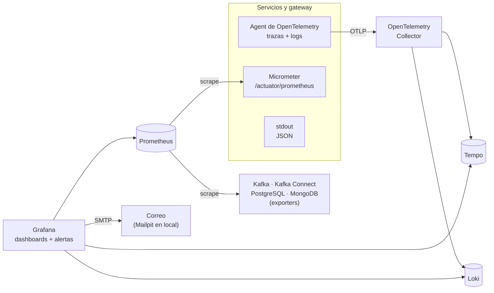
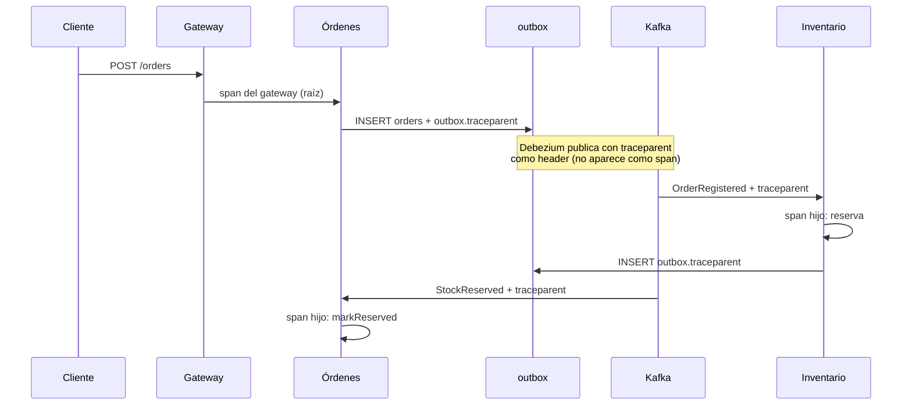

# Estrategia de observabilidad

Qué registra cada servicio, cómo se sigue un flujo de punta a punta, qué se mide y qué alerta. Las decisiones de fondo están en ADR-0014 (stack) y ADR-0027 (agent de OpenTelemetry y alertas en Grafana). Este documento las lleva a reglas concretas para implementar. Los escenarios que se deben cumplir son O1 y O2 de `quality-attributes.md`, más las medidas de D2, D3, D4, R1, R2 y R3.

Ticket: KOAL-11. Decisiones nuevas del 2026-11-15: instrumentación con el agent (2) y alertas gestionadas por Grafana (5), ambas en ADR-0027.

## 1. Panorama

| Señal | Origen | Destino | Retención en desarrollo |
|---|---|---|---|
| Trazas | Agent | Collector → Tempo | 7 días |
| Logs | Agent (y stdout para `docker logs` y `kubectl logs`) | Collector → Loki | 14 días |
| Métricas | Micrometer y exporters | Prometheus | 15 días |

Las retenciones son configurables; las de producción se deciden cuando exista ese entorno (ADR-0014).

## 2. Instrumentación

Decidido el 2026-11-15 (ADR-0027).

* **El agent de OpenTelemetry para Java** va en la imagen de los cuatro servicios y del gateway, con una versión fija. Instrumenta sin código WebFlux, WebClient, Kafka, R2DBC, MongoDB y Reactor.
* **Configuración por variables de entorno**, igual en todos:

| Variable | Valor | Para |
|---|---|---|
| `OTEL_SERVICE_NAME` | `catalog`, `inventory`, `orders`, `notifications`, `gateway` | Nombre del servicio en las tres señales |
| `OTEL_RESOURCE_ATTRIBUTES` | `deployment.environment.name=<entorno>` | Distinguir entornos |
| `OTEL_EXPORTER_OTLP_ENDPOINT` | Dirección interna del Collector | Envío de trazas y logs |
| `OTEL_METRICS_EXPORTER` | `none` | Las métricas van por Micrometer (4) |
| `OTEL_TRACES_SAMPLER` | `parentbased_always_on` | Muestreo (3.4) |

* **Lo que el agent no hace**: los atributos de negocio de los spans (3.3), los campos de contexto de los logs (6.1) y las métricas propias (4.2) se agregan en el código.

## 3. Trazas

### 3.1 Un flujo, una traza

Un pedido cruza HTTP, varios servicios, la outbox, Debezium y Kafka. La traza debe seguir ese camino sin cortarse (O1):

* **La traza nace en el gateway**, que también lleva el agent (ADR-0015).
* **Al escribir la outbox**, `OutboxEventPublisher` toma el contexto de la traza actual (`Span.current()`), que el agent mantiene también en cadenas reactivas, y guarda el header W3C `traceparent` en la columna del mismo nombre (data-model 3.1). `tracestate` no se guarda. Si no hay contexto válido, la columna queda vacía, y el test de 9 lo detecta.
* **Debezium** pasa la columna al header del mensaje (`table.fields.additional.placement`, ADR-0014). No aparece como span: su tiempo es el hueco entre la escritura de la outbox y el consumo.
* **Cada consumidor continúa la traza** desde el header: el agent crea el span de proceso como hijo del contexto que llega. Para eso, **los listeners procesan registro por registro**, no en lotes: con lotes, el agent solo puede enlazar los contextos y la traza se parte.
* **Los eventos internos del CQRS** siguen la misma cadena: la escritura en Inventario y la proyección en MongoDB quedan en la misma traza.

### 3.2 Flujos que inician su propia traza

* **Cada transición manual** (procesar, enviar, entregar, cancelar, devolver) es una petición HTTP nueva, con su traza.
* **`ExpireOrders`** y la purga de la outbox inician una traza por ejecución.
* **Un reproceso desde la DLQ** continúa el `traceparent` original del mensaje, que la DLT conserva (6.2).

Por eso un pedido tiene varias trazas, y todas se encuentran por el atributo `koala.order_id` (3.3).

### 3.3 Atributos de negocio

Cada caso de uso que trabaja con un pedido, un producto o un evento agrega el atributo al span actual:

| Atributo | Dónde |
|---|---|
| `koala.order_id` | Órdenes; Inventario, al reservar, liberar, consumir o reponer; Notificaciones |
| `koala.product_id` | Inventario, en movimientos, ajustes, traslados y la proyección |
| `koala.event_id` | Todo consumidor de Kafka |
| `koala.event_type` | Todo consumidor de Kafka |

* **Prefijo `koala.`**, para no chocar con los atributos estándar de OpenTelemetry.
* **Búsqueda en Tempo** con TraceQL, por ejemplo `{ span.koala.order_id = "<id>" }`. Es el primer paso de O1.
* **Nunca datos personales** en atributos (6.3).

### 3.4 Muestreo

* **Se guarda el 100 % de las trazas en todos los entornos por ahora** (`parentbased_always_on`). Con el volumen de referencia (10 pedidos por segundo, R1), el costo es bajo, y un muestreo perdería justo la traza del pedido atascado que O1 necesita.
* Se revisa cuando exista producción. Si se muestrea, el gateway decide y los servicios respetan la decisión del padre.

## 4. Métricas

### 4.1 Estándar

Micrometer con el registro de Prometheus, leído en `/actuator/prometheus` en el puerto de administración (`docs/strategies/security.md` 7).

* **HTTP**: `http_server_requests_seconds`, con histograma activado (`management.metrics.distribution.percentiles-histogram.http.server.requests=true`) para calcular p95 y p99 en Prometheus (R1).
* **Llamadas salientes**: `http_client_requests_seconds` hacia Catálogo.
* **Resilience4j**: estado y llamadas de cada circuit breaker y retry (D2).
* **Kafka**: métricas de los consumidores y productores de Spring Kafka.
* **JVM y pool de conexiones**: las de Micrometer, sin cambios.
* **Etiqueta común** `application` con el nombre del servicio.

### 4.2 Propias

| Métrica | Tipo | Servicio | Para |
|---|---|---|---|
| `inventory_projection_lag_seconds` | Histograma | Inventario | R3: tiempo entre `occurredAt` del evento y su aplicación en MongoDB |
| `inventory_products_out_of_sync` | Gauge | Inventario | D4: productos con `outOfSync`, contados en MongoDB |
| `inventory_sync_failure_oldest_unresolved_age_seconds` | Gauge | Inventario | ADR-0009: antigüedad de la `SYNC_FAILURE` sin resolver más antigua, leída de la BD de escritura; 0 si no hay |
| `orders_reservation_duration_seconds` | Histograma, etiqueta `from` (`REGISTERED`, `PENDING`) | Órdenes | R2: tiempo entre `registeredAt` y el paso a `RESERVED` |
| `orders_expired_total` | Contador | Órdenes | Pedidos cancelados por `ExpireOrders` |
| `notifications_deliveries_total` | Contador, etiquetas `channel`, `result` (`SENT`, `FAILED`) | Notificaciones | Avisos enviados y fallidos |

* **Las métricas en Micrometer usan nombres con puntos** (`inventory.projection.lag`), y el registro de Prometheus los convierte, con la unidad, a los nombres de la tabla.
* **Los gauges que consultan una base** se calculan cada 30 s, no en cada scrape. Así el scrape no carga la base.
* **R2 solo usa `from = REGISTERED`** para su medida: un pedido que esperó stock en `PENDING` mide otra cosa.

### 4.3 Infraestructura

| Fuente | Cómo | Para |
|---|---|---|
| Kafka Connect y Debezium | JMX exporter en la imagen de Connect | D3: estado de cada conector y de sus tareas, y retraso respecto del WAL |
| Kafka | `kafka-exporter` | Lag por grupo de consumidores y offsets por topic, incluidos los `.DLT` (O2) |
| PostgreSQL | `postgres-exporter`, una instancia por base con replicación lógica | Retraso del slot de replicación de Debezium, en bytes: la primera señal de un conector detenido (D3) |
| MongoDB | `mongodb-exporter` | Salud de la base de lectura |

### 4.4 Cardinalidad

* **Ningún id va como etiqueta**: ni `orderId`, ni `productId`, ni `sub`. Cada valor distinto crea una serie nueva en Prometheus. Los ids van en trazas y logs.
* `uri` en las métricas HTTP es la plantilla de la ruta (`/orders/{orderId}`), como la da Spring, nunca la ruta con el id.

## 5. Alertas

Decidido el 2026-11-15 (ADR-0027): las reglas las evalúa Grafana contra Prometheus, y Grafana envía los avisos.

* **Todo se versiona en el repo como provisioning de Grafana**: reglas, punto de contacto y políticas de notificación. Un cambio de umbral es un cambio de archivo, sin tocar el código de los servicios (ADR-0009).
* **Un punto de contacto, correo**, por SMTP. En local llega a Mailpit. El destinatario es hoy la persona que monitorea (ADR-0009).
* **Dos severidades**: `critical` se repite cada 1 h mientras siga activa; `warning`, cada 4 h.
* **Intervalo de evaluación de 30 s**, con el scrape de Prometheus a 15 s. Así una condición sostenida por 1 minuto avisa en menos de 2 minutos (D3, O2).

| Alerta | Condición (inicial, configurable) | Durante | Severidad | Escenario |
|---|---|---|---|---|
| Conector de Debezium caído | El conector o una tarea no está `RUNNING` | 1 min | `critical` | D3 |
| Mensajes en una DLT | Aumentó el offset de algún topic `.DLT` en los últimos 5 min | Inmediato | `critical` | O2 |
| Escalamiento de `SYNC_FAILURE` | `inventory_sync_failure_oldest_unresolved_age_seconds` > 72 000 (20 h) | Inmediato | `critical` | ADR-0009 |
| Servicio caído | `up == 0` para un servicio | 1 min | `critical` | ADR-0009, consecuencias |
| Circuito abierto | Un circuit breaker en `OPEN` | 1 min | `warning` | D2 |
| Retraso de la proyección | p99 de `inventory_projection_lag_seconds` > 3 s | 5 min | `warning` | R3 |
| Tasa de error HTTP | Respuestas 5xx > 0,1 % del total, por servicio | 10 min | `warning` | R1 |
| Lag de consumidores | Lag de un grupo > 1 000 mensajes | 10 min | `warning` | R2, R3 |
| Slot de replicación | Retraso del slot > 100 MB | 10 min | `warning` | D3 |

* **El escalamiento de `SYNC_FAILURE` usa `max()`** sobre las instancias, porque todas reportan el mismo valor (ADR-0009).
* **El umbral de 20 h vive en la regla**, no en el código.
* **Si Grafana cae**, no se evalúan alertas (ADR-0027). Ese caso lo cubre la supervisión de la plataforma.

## 6. Logs

### 6.1 Formato

* **JSON plano, un objeto por línea**, en la salida estándar. El mismo registro viaja por OTLP a Loki con los mismos campos como atributos.
* **Campos base**, en todos los registros:

| Campo | Contenido |
|---|---|
| `timestamp` | ISO-8601 en UTC, con milisegundos |
| `level` | `ERROR`, `WARN`, `INFO`, `DEBUG` |
| `service` | Igual a `OTEL_SERVICE_NAME` |
| `logger` | Clase que registra |
| `thread` | Hilo |
| `message` | Texto en español, sin datos personales |
| `traceId`, `spanId` | Del contexto actual; vacíos fuera de una traza |
| `exception` | Clase, mensaje y stack trace, solo si hay excepción |

* **Campos de contexto**, solo cuando aplican: `orderId`, `productId`, `eventId`, `eventType`, `alertId`, `notificationId`, `securityEvent` (`docs/strategies/security.md` 8).
* **Nombres en camelCase**, como en la API.
* **El `traceId` lo pone el agent** en el MDC. Se configura para usar `traceId` y `spanId` en vez de sus nombres por defecto (`trace_id`, `span_id`).
* **Los campos de contexto se pasan como pares clave-valor** del registro (`log.atInfo().addKeyValue("orderId", id)`, de SLF4J 2), no por MDC: en código reactivo el MDC no viaja entre hilos. El agent exporta esos pares como atributos del log (`capture-key-value-pair-attributes`).
* **El encoder exacto** (el formato estructurado de Spring Boot o `logstash-logback-encoder`) se elige al implementar el primer servicio, configurado para producir estos nombres.

### 6.2 Qué se registra y en qué nivel

| Nivel | Cuándo | Ejemplos |
|---|---|---|
| `ERROR` | Algo necesita acción de una persona | Un mensaje enviado a la DLT; una excepción no esperada que termina en 5xx |
| `WARN` | Algo anómalo pero controlado | Un reintento; circuito abierto; un evento descartado por estado incompatible; los `securityEvent` |
| `INFO` | Hechos de negocio | Pedido registrado, transición de estado, guía registrada, ajuste de stock, aviso enviado |
| `DEBUG` | Detalle para desarrollar | Apagado fuera de local |

* **No hay log de acceso por petición** en los servicios: cada petición ya está en las trazas y en las métricas HTTP.
* **Un mensaje a la DLT** registra el topic de origen, la partición, el offset, el `eventId`, el número de intentos y la causa (O2). La DLT conserva el payload y todos los headers del mensaje original, incluido `traceparent`, y Spring agrega los de la excepción (`kafka_dlt-*`). El número de intentos se agrega como header (`kafka_deliveryAttempt`).
* **Una DLT por topic, compartida por sus consumidores.** `orders.order.events.DLT` recibe los fallos de Inventario y de Notificaciones. El consumidor que falló se identifica por el header `kafka_dlt-original-consumer-group`, que agrega Spring. Al reprocesarlo, el mensaje vuelve al topic original y le llega a todos sus consumidores: el que ya lo había procesado lo descarta por idempotencia (`docs/architecture/data-model.md` 3.2; en Notificaciones, por `(eventId, channel)`).

### 6.3 Datos personales y secretos

* **Nunca se registran**: nombre, email, teléfono y dirección del destinatario; el contenido de los avisos (`subject`, `body`); tokens y el header `Authorization`; secretos y contraseñas.
* **El `recipient` de Notificaciones aparece enmascarado** cuando un log lo necesita: `j***@dominio.com`, `+51*****789`.
* **Los payloads de eventos no se registran completos**, porque los de pedido llevan el contacto. Se registran `eventId`, `eventType` y los ids.

### 6.4 Etiquetas en Loki

* **Solo de baja cardinalidad**: `service_name`, `level` y `deployment_environment`.
* **`traceId`, `orderId` y los demás ids van como metadatos estructurados**, no como etiquetas. Loki crea un índice por cada combinación de etiquetas, y un id por etiqueta lo degrada.
* Desde una traza en Tempo se salta a sus logs en Loki por `traceId`, configurado en las fuentes de datos de Grafana.

## 7. Salud

* **`/actuator/health/liveness` y `/actuator/health/readiness`**, en el puerto de administración, para las sondas de Docker y de Kubernetes.
* **`readiness` incluye solo la base propia del servicio**: PostgreSQL, y en Inventario también MongoDB.
* **No incluye Kafka**: con Kafka caído, los servicios siguen aceptando comandos y los eventos esperan en la outbox (D3). Tampoco incluye a otros servicios ni a Keycloak: si Catálogo cae, Inventario y Órdenes deben seguir atendiendo lo que no lo necesita, y el circuit breaker ya lo maneja (D2).
* **`liveness`** solo indica que la aplicación responde, sin dependencias. Una base caída no debe reiniciar el contenedor.

## 8. Dashboards

Versionados en el repo como JSON y cargados por provisioning de Grafana. Ningún dashboard se edita solo en la interfaz: un cambio se exporta y se guarda en el repo.

| Dashboard | Contenido | Escenarios |
|---|---|---|
| Resumen | Tasa, errores y latencia p95/p99 por servicio y ruta; servicios arriba; alertas activas | R1 |
| Saga de pedidos | Pedidos registrados por minuto, `orders_reservation_duration_seconds` p95/p99, pedidos `PENDING`, expirados, lag de los consumidores de la saga | R2, O1 |
| CQRS de Inventario | `inventory_projection_lag_seconds` p95/p99, productos `outOfSync`, antigüedad de la `SYNC_FAILURE` más antigua | R3, D4 |
| Kafka y Debezium | Estado de los conectores, retraso del slot de replicación, lag por grupo, **un panel por topic `.DLT`** con su conteo de mensajes | D3, O2 |
| Resiliencia | Estado de los circuit breakers, reintentos, latencia hacia Catálogo | D2 |
| Notificaciones | Avisos enviados y fallidos por canal | — |
| JVM | Memoria, GC, hilos y pool de conexiones por servicio | — |

**Ubicación propuesta en el repo**: `deploy/observability/`, con la configuración del Collector, Tempo, Loki y Prometheus, y `grafana/` con las fuentes de datos, los dashboards y el alerting. La estructura final se fija al armar el Docker Compose.

## 9. Verificación

| Qué | Cómo |
|---|---|
| O1: una sola traza de la petición HTTP al consumidor | Test de punta a punta: una petición HTTP y su mensaje en Kafka comparten el `traceId` (ADR-0014). Incluye una escritura de la outbox dentro de una cadena reactiva, para detectar una columna `traceparent` vacía (ADR-0027). |
| O1: encontrar las trazas por `orderId` | Revisión guiada con un fallo inyectado (consumidor de Inventario detenido): desde el `orderId` hasta el salto que falló en menos de 5 minutos, sin entrar a las bases ni a los contenedores. |
| O2: la DLT conserva payload, headers y causa | Test de integración que fuerza un error no recuperable y revisa el mensaje en la DLT, incluido `traceparent` y el número de intentos. |
| 100 % de los logs en JSON con `traceId` | Test que captura la salida de un caso de uso y valida el JSON y sus campos base. |
| Sin datos personales en los logs | Test que registra un pedido completo y busca el email, el teléfono y la dirección en los logs capturados. |
| Las alertas existen y avisan | Revisión del provisioning contra la tabla de 5, y en local, forzar cada condición crítica y ver el correo en Mailpit. |
| Métricas sin ids como etiquetas | Revisión de `/actuator/prometheus` de cada servicio en los tests de integración. |

## Referencias

* `docs/README.md` 3.1, 5, 5.1
* `docs/architecture/quality-attributes.md` D2, D3, D4, R1, R2, R3, O1, O2
* `docs/architecture/c4-model.md`, nivel 2b
* `docs/architecture/data-model.md` 3.1
* `docs/strategies/security.md` 7, 8
* ADR-0009, ADR-0010, ADR-0014, ADR-0015, ADR-0027
