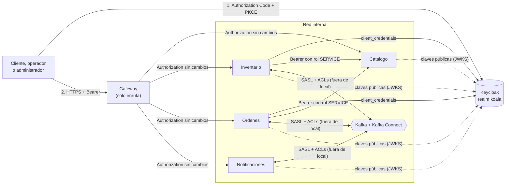
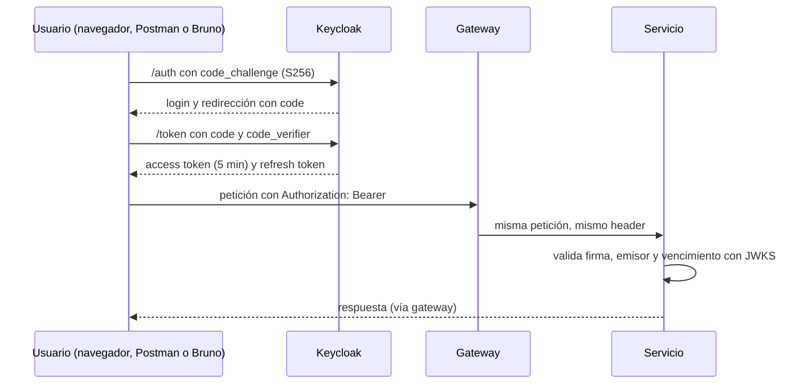

# Estrategia de seguridad

Cómo se autentican los usuarios y los servicios, cómo se autoriza cada operación y cómo se protege la comunicación entre servicios. Las decisiones de fondo están en ADR-0013 (Keycloak y resource servers), ADR-0015 (gateway), ADR-0022 (tokens entre servicios), ADR-0023 (roles y destinatario) y ADR-0026 (Kafka). Este documento las lleva a reglas concretas para implementar.

Ticket: KOAL-11. Decisiones nuevas del 2026-11-15: flujos de token (3), un solo rol de negocio por usuario (2.2), sin validación de audiencia por ahora (4.1) y acceso controlado a Kafka (6.2, ADR-0026).

## 1. Panorama

* **Keycloak emite todos los tokens** y **cada servicio valida el suyo** (ADR-0013). El gateway no decide nada de seguridad: reenvía el `Authorization` tal cual (ADR-0015).
* **Hay dos tipos de token**: el del usuario, que entra por el gateway, y el de cada servicio, para llamar a otro (ADR-0022). Nunca se reenvía el del usuario de un servicio a otro.
* **Kafka no usa tokens**: se protege en el broker (ADR-0026).

## 2. Identidad: Keycloak

### 2.1 Realm y clients

Un realm, `koala`, que se versiona en el repo como exportación JSON y se importa al levantar Keycloak. Importar no modifica un realm que ya existe (ADR-0013): un cambio en un entorno ya creado se aplica también por consola o por la API de Keycloak.

| Client | Tipo | Flujo | Entornos | Para |
|---|---|---|---|---|
| `koala-web` | Público | Authorization Code + PKCE (`S256`) | Todos | El futuro frontend y las pruebas manuales con Postman o Bruno |
| `koala-test` | Confidencial | Direct Access Grants (usuario y contraseña) | **Solo desarrollo y tests** | Scripts y tests de integración (3.2) |
| `inventory-service` | Confidencial, con service account | `client_credentials` | Todos | Llamadas de Inventario a Catálogo |
| `orders-service` | Confidencial, con service account | `client_credentials` | Todos | Llamadas de Órdenes a Catálogo |

* **Catálogo, Notificaciones y el gateway no tienen client**: no llaman a otros servicios. Solo validan tokens, y para eso basta con las claves públicas del realm.
* **Duración de los tokens** (ADR-0013): access token de 5 minutos y sesión de 30 minutos de inactividad, configurados en el realm por entorno. Los servicios no conocen estos valores.

### 2.2 Roles

Roles del realm, en `realm_access.roles` (ADR-0013, ADR-0023):

| Rol | Quién lo tiene |
|---|---|
| `ADMIN` | Administradores. |
| `OPERATOR` | Personal que opera el día a día (dark store). |
| `CUSTOMER` | Clientes que registran sus propios pedidos. |
| `SERVICE` | Solo las service accounts de `inventory-service` y `orders-service`. Nunca un usuario. |

* **Un solo rol de negocio por usuario** (decidido 2026-11-15): `ADMIN`, `OPERATOR` o `CUSTOMER`. Es una regla de administración del realm.
* **Si un token llega con varios**, porque el realm está mal configurado, prevalece el de mayor privilegio (`ADMIN` > `OPERATOR` > `CUSTOMER`), y queda una advertencia en el log (`MULTIPLE_BUSINESS_ROLES`, 8). Así, un usuario que también es `CUSTOMER` no ve "solo sus pedidos" por accidente.
* **No hay jerarquía de roles**: un `ADMIN` no hereda los permisos de `OPERATOR`. Cada operación lista explícitamente todos sus roles en `x-roles`.
* **Un rol nuevo**, por ejemplo almacenero, se crea en el realm y se agrega a los `x-roles` de las operaciones que habilita. No cambia este modelo.

### 2.3 Claims que usan los servicios

| Claim | Uso |
|---|---|
| `iss` | Validación del emisor (4.1). |
| `exp`, `nbf` | Vencimiento. |
| `sub` | Identidad del usuario: `registeredBy.userId`, `customerId` para un `CUSTOMER` (ADR-0023), autor de ajustes y de alertas (data-model 2.6), y la auditoría. |
| `realm_access.roles` | Autorización (5). |

Ningún otro claim interviene en una decisión. `preferred_username` y `email` no se guardan ni se registran en los logs: son datos personales y el `sub` basta para identificar.

## 3. Flujos de token

Decidido el 2026-11-15.

### 3.1 Usuarios: Authorization Code + PKCE

* Es el único flujo de usuario fuera de desarrollo. `koala-web` es público, porque un frontend no puede guardar un secreto, y PKCE reemplaza al secreto.
* **El refresh token** lo maneja el cliente. Los servicios nunca lo ven.
* **Hoy, sin frontend**, se prueba con Postman o Bruno, que soportan este flujo.

### 3.2 Desarrollo y tests: `koala-test`

* El flujo de usuario y contraseña está desaconsejado en OAuth 2.1, así que **solo existe en el realm de desarrollo y en el de tests**. El realm de los demás entornos no incluye `koala-test`.
* Los tests de integración levantan Keycloak con Testcontainers, importan el realm de tests y piden tokens con `koala-test` para los usuarios de S2: dos clientes, un operador y un administrador (`quality-attributes.md` S2).
* Los usuarios y contraseñas de desarrollo están en el realm versionado. Son valores fijos de desarrollo, no secretos.

### 3.3 Servicios: `client_credentials`

Se detalla en 6.1.

## 4. Validación del token en cada servicio

### 4.1 Qué se valida

Cada servicio es un resource server de Spring Security (WebFlux) y valida por sí mismo (ADR-0013):

* **Firma** con las claves públicas del realm (JWKS), sin consultar a Keycloak en cada petición.
* **Emisor** (`iss`) igual al del realm.
* **Vencimiento** (`exp`, `nbf`), con la tolerancia de reloj por defecto de Spring (60 s).
* **La audiencia (`aud`) no se valida por ahora** (decidido 2026-11-15). Todo vive en un único realm propio, y los roles ya limitan qué puede hacer cada token. Además, el token de un usuario tendría que incluir los cuatro servicios en `aud`, porque el gateway lo reenvía a cualquiera, así que la validación protegería poco. Se revisa cuando existan clientes externos (ADR-0023, 10).

### 4.2 Claves y emisor

* **Las claves se descargan al primer uso y quedan en caché.** Spring las vuelve a pedir si llega un token firmado con una clave que no conoce (`kid` nuevo), así que una rotación de claves en Keycloak no exige reiniciar los servicios.
* **Si Keycloak cae**, los tokens vigentes siguen validándose con las claves en caché hasta que vencen (ADR-0013).
* **El emisor debe ser el mismo por dentro y por fuera.** El token lo pide el usuario por la dirección pública de Keycloak, pero los servicios llegan a Keycloak por la red interna. Si `iss` cambia según la dirección, la validación falla. Por eso:
  * Keycloak se configura con un nombre público fijo (`KC_HOSTNAME`), y todos los tokens llevan ese `iss`.
  * Cada servicio configura por separado el emisor esperado (`issuer-uri` o validador de `iss`) y la dirección interna de las claves (`jwk-set-uri`).

### 4.3 Roles a autoridades

* **Un convertidor** lee `realm_access.roles` y los convierte en autoridades `ROLE_<rol>`, porque Keycloak no usa el claim estándar (ADR-0013). Aplica la regla de varios roles de 2.2.
* **Cada servicio tiene su copia**, porque no hay librería compartida entre módulos (ADR-0018). Es un costo aceptado en ADR-0013: el código es corto y sus tests son iguales en los cuatro servicios.

## 5. Autorización

### 5.1 Dónde se decide

| Qué | Dónde | Respuesta |
|---|---|---|
| Hay un token válido | Filtro del resource server, antes de cualquier controlador | `401` |
| El token tiene uno de los roles de la operación | Adaptador web, por operación (`@PreAuthorize` en el método del controlador, escrito a mano según el contrato, ADR-0021) | `403` |
| El pedido es del `CUSTOMER` que lo pide | Caso de uso, en la capa `application`, con el `Actor` que recibe del adaptador | `404`, igual que uno inexistente |
| La transición es válida para el rol (por ejemplo, cancelar desde `PROCESSED` solo `ADMIN`) | Dominio (`Order.cancel`) | `409` |

* **El adaptador web arma el `Actor`** (`type` + `userId`) desde el token y lo pasa al caso de uso. El dominio no conoce Spring Security ni el JWT (ADR-0002).
* **`customerId` sale siempre del `sub`**, nunca del cuerpo de la petición (ADR-0013, ADR-0023).
* **Un `CUSTOMER` solo ve sus pedidos**: `GET /orders` filtra por su `customerId`, y `GET`, `cancel` sobre un pedido ajeno responden `404` para no revelar qué ids existen (S2).
* **Los `x-roles` del contrato son la fuente de verdad.** Un test compara, para cada operación del contrato, sus `x-roles` con los roles que exige el controlador (11).

### 5.2 Roles por endpoint

Resumen de los `x-roles` de `docs/api/`. Si hay diferencia, manda el contrato.

**Catálogo** (`/api/v1/catalog`)

| Operación | `ADMIN` | `OPERATOR` | `CUSTOMER` | `SERVICE` |
|---|:-:|:-:|:-:|:-:|
| `GET /products`, `GET /products/{id}` | ✓ | ✓ | ✓ | ✓ |
| `GET /categories`, `GET /categories/{id}` | ✓ | ✓ | ✓ | |
| `GET /units-of-measure`, `GET /units-of-measure/{id}` | ✓ | ✓ | | |
| Crear, modificar, activar y desactivar productos, categorías y unidades; `PUT /products/{id}/minimum-stock` | ✓ | | | |

**Inventario** (`/api/v1/inventory`)

| Operación | `ADMIN` | `OPERATOR` | `CUSTOMER` | `SERVICE` |
|---|:-:|:-:|:-:|:-:|
| Guías de remisión: listar, consultar, registrar | ✓ | ✓ | | |
| `GET /locations`, `GET /locations/{id}` | ✓ | ✓ | | |
| Crear, modificar, activar y desactivar ubicaciones | ✓ | | | |
| Traslados: registrar y consultar | ✓ | ✓ | | |
| Ajustes de stock: listar, consultar, registrar | ✓ | | | |
| `GET /stock`, `GET /products/{id}/stock`, `GET /products/{id}/kardex` | ✓ | ✓ | | |
| `POST /products/{id}/rebuild-projection` | ✓ | | | |
| `GET /alerts`, `POST /alerts/{id}/acknowledge` | ✓ | ✓ | | |
| `POST /alerts/{id}/resolve` | ✓ | | | |

**Órdenes** (`/api/v1/orders`)

| Operación | `ADMIN` | `OPERATOR` | `CUSTOMER` | `SERVICE` |
|---|:-:|:-:|:-:|:-:|
| `GET /orders`, `POST /orders`, `GET /orders/{id}`, `POST /orders/{id}/cancel` | ✓ | ✓ | ✓ (solo los suyos) | |
| `POST /orders/{id}/process`, `/ship`, `/deliver` | ✓ | ✓ | | |
| `POST /orders/{id}/return` | ✓ | | | |
| `GET /orders/incidents` | ✓ | | | |
| `GET /orders/alerts`, `POST /orders/alerts/{id}/acknowledge` | ✓ | ✓ | | |
| `POST /orders/alerts/{id}/resolve` | ✓ | | | |

Cancelar desde `PROCESSED` también entra por `POST /orders/{id}/cancel`, pero solo lo permite el dominio para `ADMIN` (5.1).

**Notificaciones** (`/api/v1/notifications`)

| Operación | `ADMIN` | `OPERATOR` | `CUSTOMER` | `SERVICE` |
|---|:-:|:-:|:-:|:-:|
| `GET /notifications` | ✓ | ✓ | | |
| `POST /notifications/{id}/reprocess` | ✓ | | | |

## 6. Comunicación entre servicios

### 6.1 REST: token propio de cada servicio

ADR-0022. Hoy solo Inventario y Órdenes llaman a Catálogo.

* **Cada llamada usa el token del servicio que llama**, también si la originó un usuario. Catálogo no sabe qué usuario estaba detrás, y no lo necesita.
* **El token se pide con `client_credentials`** y se reutiliza hasta poco antes de vencer. Lo maneja el cliente OAuth2 de Spring Security sobre el `WebClient` (`ServerOAuth2AuthorizedClientExchangeFilterFunction`), que lo renueva solo.
* **Si Keycloak no responde al pedir el token**, la llamada falla como cualquier otro error de la llamada: cuenta para el retry y el circuit breaker de Resilience4j de esa llamada, sin una capa de reintentos propia (ADR-0010, `docs/README.md` 5.1).
* **El secreto llega por variable de entorno** (`INVENTORY_CLIENT_SECRET`, `ORDERS_CLIENT_SECRET`), distinto por entorno. Un secreto expuesto se revoca solo para ese servicio.

### 6.2 Kafka: acceso controlado al broker

ADR-0026. Los eventos no llevan token: el control es quién se conecta al broker y qué puede hacer cada uno.

**En todos los entornos**

* Kafka y Kafka Connect no se exponen fuera de la red interna: en Docker Compose no se publican sus puertos, y en kind no tienen Service externo.
* La API REST de Kafka Connect (puerto 8083) solo es accesible desde la red interna, porque permite reconfigurar el conector del outbox.

**Fuera de local**

* **SASL/SCRAM-SHA-512** y **TLS** entre clientes y broker.
* **Un usuario por componente.** Cada conector de Debezium usa el suyo, con la configuración de cliente por conector de Kafka Connect (`producer.override.*`).
* **`auto.create.topics.enable=false`**: los topics se crean al desplegar, no desde las aplicaciones.
* **ACLs con lo mínimo:**

| Usuario | Escribe | Lee |
|---|---|---|
| `connect-inventory` (Debezium, outbox de Inventario) | `inventory.reservation.events`, `inventory.internal.events` | — |
| `connect-orders` (Debezium, outbox de Órdenes) | `orders.order.events` | — |
| `inventory` | `orders.order.events.DLT`, `inventory.internal.events.DLT` | `orders.order.events`, `inventory.internal.events` |
| `orders` | `inventory.reservation.events.DLT` | `inventory.reservation.events` |
| `notifications` | `orders.order.events.DLT` | `orders.order.events` |

* Cada microservicio tiene además `READ` sobre sus propios grupos de consumidores. Kafka Connect tiene permiso sobre sus topics internos de configuración, offsets y estado.
* **Solo Debezium escribe en los topics de eventos.** Un evento falso exige las credenciales de un conector, no solo acceso a la red.
* **La herramienta para reprocesar la DLQ**, pendiente (ADR-0010), tendrá su propio usuario, con escritura explícita en los topics originales y uso auditado.

**En local**: no hay autenticación en el broker. La protección es solo de red, y es un costo aceptado (ADR-0026).

### 6.3 Gateway

* **Solo enruta `/api/v1/**`** hacia cada servicio (ADR-0015). No enruta actuator ni la API de Kafka Connect.
* **No valida ni modifica el token**: reenvía `Authorization` sin cambios.
* **CORS** se configura aquí cuando exista el frontend, con los orígenes permitidos por entorno.

## 7. Endpoints sin autenticar

* **Solo salud y métricas** (ADR-0013): `/actuator/health/**` y `/actuator/prometheus`. La lista es explícita en la configuración de seguridad de cada servicio, y todo lo demás exige token.
* **Actuator se publica en un puerto de administración aparte** (`management.server.port`, por ejemplo 8081), que el gateway no enruta. Así, salud y métricas quedan accesibles para Prometheus y para las sondas de Docker y de Kubernetes, pero no desde afuera.
* Los demás endpoints de actuator no se exponen.

## 8. Auditoría de accesos

Cada rechazo y cada situación anómala deja un registro en el log con el campo `securityEvent` (ADR-0013, S1, S2). El formato general de los logs está en `docs/strategies/observability.md`.

| `securityEvent` | Cuándo | Nivel |
|---|---|---|
| `AUTHENTICATION_FAILED` | `401`: sin token, vencido, con firma o emisor inválidos | `WARN` |
| `ACCESS_DENIED` | `403`: el token no tiene el rol de la operación | `WARN` |
| `FOREIGN_ORDER_ACCESS` | `404` a un `CUSTOMER` por un pedido ajeno | `WARN` |
| `MULTIPLE_BUSINESS_ROLES` | Un token con más de un rol de negocio (2.2) | `WARN` |

* **Campos**: `securityEvent`, `traceId`, método, ruta, `sub` (si hay token válido), roles del token y roles exigidos. En `FOREIGN_ORDER_ACCESS`, también el `orderId`.
* **Nunca se registra el token**, ni completo ni en parte, ni el header `Authorization`.
* **Retención**: la de los logs, 14 días en desarrollo (ADR-0014). Si hace falta más, se agrega una tabla de auditoría por servicio cuando exista producción (ADR-0013).

## 9. Transporte y secretos

* **TLS**: en Docker Compose local, todo va por HTTP. Cuando exista un entorno real, TLS termina en el gateway. El tráfico dentro de la red interna sigue sin cifrar por ahora (10), salvo Kafka fuera de local (6.2).
* **Secretos** (ADR-0022, ADR-0026): secretos de clients, contraseñas de bases y credenciales SCRAM llegan por variables de entorno, distintos por servicio y por entorno. En Docker Compose viven en un `.env` que no se versiona; el repo tiene un `.env.example` sin valores reales. En kind, en `Secret` de Kubernetes.
* **El realm versionado** solo tiene valores de desarrollo. El de cada entorno real genera sus propios secretos.

## 10. Pendientes y endurecimiento futuro

* **Validar la audiencia (`aud`)** cuando existan clientes externos que registren pedidos (ADR-0023).
* **TLS dentro de la red interna**, entre gateway y servicios y hacia las bases.
* **SASL/OAUTHBEARER con Keycloak** para Kafka, en vez de SCRAM, si se quiere una sola fuente de identidad (ADR-0026).
* **Tabla de auditoría** por servicio, si 14 días de logs no alcanzan (ADR-0013).
* **Revocación inmediata de tokens**: hoy un rol retirado sigue vigente hasta 5 minutos (ADR-0013).
* **Límite de peticiones** (rate limiting) en el gateway, cuando haya tráfico externo.
* **Usuario de Kafka para la herramienta de reproceso de la DLQ** (6.2), cuando se defina (ADR-0010).

## 11. Verificación

| Qué | Cómo |
|---|---|
| S1: el 100 % de los endpoints de negocio responde `401` sin token, vencido o con firma inválida | Test que recorre todos los endpoints registrados de cada servicio, no una lista escrita a mano, en CI (`quality-attributes.md` S1). |
| S2: pedido ajeno `404`, rol faltante `403`, sin cambios de estado | Tests de integración con Keycloak en Testcontainers y los usuarios de 3.2. |
| Roles por operación iguales a los `x-roles` | Test que lee el contrato y compara cada operación con los roles que exige su controlador. |
| Llamadas entre servicios | Test de integración que llama a Catálogo con el token de servicio y comprueba que un token sin `SERVICE` recibe `403` (ADR-0022). |
| Varios roles de negocio | Test unitario del convertidor de roles: prevalece el de mayor privilegio y se registra la advertencia. |
| Kafka (ADR-0026) | Revisión de Docker Compose y kind: sin puertos ni Services externos de Kafka y Connect. Fuera de local, test de humo: un usuario sin ACL no puede publicar en `orders.order.events`. |
| El dominio no conoce la seguridad | Regla de ArchUnit: `domain` y `application` no dependen de `org.springframework.security` (`docs/strategies/testing.md`). |

## Referencias

* `docs/README.md` 5, 5.1
* `docs/api/README.md`, Seguridad, y los `x-roles` de `docs/api/`
* `docs/architecture/quality-attributes.md` S1, S2, S3
* `docs/architecture/context-map.md` R5
* ADR-0002, ADR-0010, ADR-0013, ADR-0014, ADR-0015, ADR-0018, ADR-0021, ADR-0022, ADR-0023, ADR-0026
