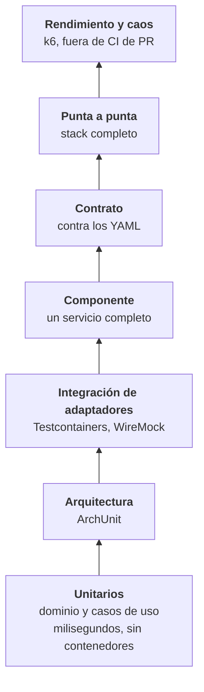

# Estrategia de testing

Qué se prueba en cada nivel, con qué herramientas, qué reglas de arquitectura se verifican y cuándo corre cada cosa. Las decisiones de fondo están en ADR-0002 (hexagonal y reglas de ArchUnit), ADR-0018 (monorepo), ADR-0021 (contrato OpenAPI primero) y ADR-0028 (tests de contrato). Cada escenario de `quality-attributes.md` tiene su verificación en la sección 8.

Ticket: KOAL-11. Decisiones nuevas del 2026-11-15: tests de contrato contra los YAML (4.4, ADR-0028), `@Transactional` como única dependencia de Spring en `application` (5, ADR-0002) y tests de punta a punta en cada PR (6).

## 1. Pirámide



* **La mayoría de los tests son unitarios.** La hexagonal permite probar las reglas de negocio sin levantar nada (ADR-0002): transiciones del pedido, reserva todo o nada, bordes de 48 h, saldos del kardex.
* **Cada adaptador se prueba contra su tecnología real**, con Testcontainers, nunca contra una base en memoria que se comporta distinto.
* **Pocos tests de punta a punta**, para lo que solo se ve con el sistema completo: la saga, Debezium y la traza entre servicios.
* No hay una proporción fija. La regla es probar cada cosa en el nivel más bajo donde se puede ver el error.

## 2. Herramientas por nivel

| Nivel | Herramientas | Corre en |
|---|---|---|
| Unitario | JUnit 5, AssertJ, Mockito, `StepVerifier` (reactor-test), `Clock` fijo | Cada build (surefire) |
| Arquitectura | ArchUnit | Cada build (surefire) |
| Integración de adaptadores | Testcontainers (PostgreSQL, MongoDB, Kafka, Keycloak), WireMock, Toxiproxy, `WebTestClient` | Cada build (failsafe) |
| Componente | `@SpringBootTest` + Testcontainers, `WebTestClient` | Cada build (failsafe) |
| Contrato | Validador de JSON Schema, springdoc, `oasdiff`, `asyncapi diff` | Cada build y cada PR |
| Punta a punta | Módulo `e2e`, Testcontainers con Docker Compose | Cada PR a `main` |
| Rendimiento | k6 | A mano o `workflow_dispatch` |
| Caos | Procedimientos versionados, `docker stop`, Toxiproxy | A mano, antes de una versión |

* **`*Test`** son los tests sin contenedores y los corre surefire. **`*IT`** son los que usan contenedores y los corre failsafe. Así `mvn test` es rápido y `mvn verify` corre todo.
* **Las versiones de Testcontainers, ArchUnit y demás** se fijan en el POM padre (ADR-0018).
* **Los contenedores se reutilizan dentro de un módulo**: un contenedor por tipo, compartido por las clases de test del servicio, con los datos limpiados entre tests. Levantar PostgreSQL por cada clase haría la suite lenta.

## 3. Datos y tiempo en los tests

* **El reloj es un puerto** (`application.port.out`, ADR-0002). Los tests usan un `Clock` fijo, así los bordes de 48 h, la expiración de pedidos y las fechas en `America/Lima` son deterministas.
* **Nada llama a `Instant.now()` ni a `LocalDate.now()`** fuera del adaptador del reloj (regla 9 de 5).
* **Cada test arma sus propios datos** con builders del dominio. No hay datos compartidos entre tests ni scripts SQL de carga.
* **Los tokens de los tests** salen del realm de tests con `koala-test` (`docs/strategies/security.md` 3.2). En los tests del adaptador web sin Keycloak se usa `mockJwt()` de Spring Security.

## 4. Qué se prueba en cada nivel

### 4.1 Unitarios

* **Dominio**, sin mocks: invariantes y transiciones de cada agregado. Por ejemplo:
  * `Order`: todas las transiciones válidas de `docs/README.md` 2.1 y el rechazo de las demás, y las reglas de cancelación por actor.
  * `ProductStock`: `reserve`, `release`, `consume`, `decrease`, y que el disponible nunca sea negativo.
  * `StockMovement.unusual` en los bordes de S3: 47 h 59 min, 48 h y 48 h 1 min, en ambas direcciones.
  * **Tests del kardex parametrizados por `MovementType`**, así un tipo nuevo como `WRITE_OFF` entra al agregarlo al enum (M1).
* **Casos de uso** (`application.service`), con los puertos de salida simulados con Mockito y verificados con `StepVerifier`: qué se guarda, qué evento se publica y qué pasa cuando un puerto falla.
* **Cobertura**: JaCoCo, con un umbral del **80 % de ramas** solo en `domain` y `application`, configurable. Los adaptadores se cubren con los tests de integración y no cuentan para el umbral.

### 4.2 Integración de adaptadores

| Adaptador | Qué se prueba | Con qué |
|---|---|---|
| `adapter.out.persistence` (R2DBC) | Guardar y cargar cada agregado con sus tablas hijas; bloqueo optimista; restricciones e índices únicos de `data-model.md` | PostgreSQL en Testcontainers, con las migraciones de Flyway reales |
| Lado de lectura (MongoDB) | Las reglas de aplicación de eventos de data-model 8.5: duplicados, `sequence` repetido, hueco y reconstrucción | MongoDB en Testcontainers |
| `adapter.out.outbox` | La fila completa: `payload`, `event_type`, `event_key` y `traceparent` | PostgreSQL en Testcontainers |
| `adapter.out.catalog` | Mapeo de la respuesta (ACL), token de servicio, timeout, retry y circuit breaker (D2) | WireMock y Toxiproxy |
| `adapter.in.kafka` | Deserialización, idempotencia con `processed_events`, envío a la DLT con sus headers (O2) | Kafka en Testcontainers |
| `adapter.in.web` | Mapeo de la petición y de los errores RFC 9457, roles por operación con `mockJwt()` (403) | `@WebFluxTest` y `WebTestClient`, con los casos de uso simulados |
| Notificaciones, envío de email | Plantilla y envío por SMTP | Mailpit en Testcontainers |

### 4.3 Componente

Un servicio completo con sus contenedores, probado por sus entradas reales: HTTP y Kafka.

* **Flujos de cada caso de uso** de punta a punta dentro del servicio: por ejemplo, registrar un pedido por HTTP y comprobar la fila de `orders`, la de `outbox` y la respuesta.
* **S1**: un test recorre **todos los endpoints registrados** del servicio, leídos de Spring y no de una lista escrita a mano, y comprueba el `401` sin token, con token vencido y con firma inválida.
* **S2**: Keycloak en Testcontainers con los usuarios del realm de tests (dos clientes, un operador y un administrador): pedido ajeno `404`, rol faltante `403`, sin cambios en la base.
* **Roles iguales a los `x-roles`**: un test lee el contrato y compara cada operación con los roles que exige su controlador (`docs/strategies/security.md` 5.1).
* **Logs**: un test captura la salida de un caso de uso, valida el JSON y sus campos base, y comprueba que no aparecen el email, el teléfono ni la dirección (`docs/strategies/observability.md` 9).
* **Debezium no participa**: el test verifica la fila de la outbox. La publicación real se prueba en el nivel de punta a punta (6).

### 4.4 Contrato

Decidido el 2026-11-15 (ADR-0028): se valida contra los YAML de `docs/api/`, sin herramienta aparte.

| Qué | Cómo |
|---|---|
| REST: el código cumple el OpenAPI | En CI el servicio arranca, springdoc genera su contrato y se compara con el YAML (ADR-0021). |
| Eventos: el productor cumple el AsyncAPI | Cada caso de uso que publica escribe la fila de la outbox, y su `payload` se valida contra el JSON Schema del mensaje, con el envelope de `events-common.yaml`. También se validan `event_type` y `event_key`. |
| Eventos: el consumidor acepta el contrato | Cada servicio consume los `examples` de los mensajes donde aparece en `x-consumers`, y también cada ejemplo con un campo desconocido agregado (M3). |
| Cambios incompatibles | `oasdiff` y `asyncapi diff` contra los YAML de `main`. Un cambio incompatible falla el PR (ADR-0019, ADR-0024). |

* **Cada mensaje necesita al menos un ejemplo por variante relevante** en su AsyncAPI, por ejemplo `OrderCancelled` desde `RESERVED` y desde `PROCESSED`, porque los ejemplos son los datos del test del consumidor.
* **Los consumidores ignoran los campos desconocidos** (`docs/api/README.md`, Eventos): el deserializador se configura así y el test lo comprueba.

## 5. Reglas de ArchUnit

En cada servicio, en un test `ArchitectureTest` que corre con los unitarios. Las reglas se copian en los cuatro servicios, porque no hay módulos compartidos (ADR-0018).

**Estructura de paquetes**, la de `docs/architecture/c4-model.md`, nivel 3, más `config`:

```text
<servicio>
├── domain
├── application
│   ├── port.in
│   ├── port.out
│   └── service
├── adapter
│   ├── in.*      (web, kafka, scheduler)
│   └── out.*     (persistence, catalog, outbox, ...)
└── config        ← declaración de beans y configuración de Spring
```

| # | Regla | Origen |
|---|---|---|
| 1 | `domain` no depende de ningún otro paquete de la aplicación, ni de Spring, Reactor, R2DBC, MongoDB, Kafka ni Jackson. | ADR-0002 |
| 2 | `application` depende solo de `domain` y de Reactor, **salvo `@Transactional`** (`org.springframework.transaction.annotation`), permitido solo en `application.service`. No depende de `adapter` ni de `config`. | ADR-0002, decidido 2026-11-15 |
| 3 | Un adaptador de entrada solo usa `application.port.in`. Los adaptadores no se llaman entre sí. | ADR-0002 |
| 4 | Solo `adapter.out.*` implementa las interfaces de `application.port.out`. | ADR-0002 |
| 5 | `domain` y `application` no llevan anotaciones de estereotipo de Spring (`@Service`, `@Component`): sus beans se declaran en `config`. | Consecuencia de la regla 2 |
| 6 | `domain` y `application` no dependen de `org.springframework.security`. El `Actor` llega armado desde el adaptador web. | `security.md` 5.1 |
| 7 | En Inventario, ningún puerto ni repositorio de `StockMovement` tiene métodos de actualización o borrado, y ningún controlador expone `PUT`, `PATCH` o `DELETE` sobre movimientos. | S3 |
| 8 | Nadie usa `org.slf4j.MDC`: los campos de contexto de los logs van como pares clave-valor. | `observability.md` 6.1 |
| 9 | Nadie llama a `Instant.now()`, `LocalDate.now()`, `LocalDateTime.now()` ni `Clock.systemUTC()` fuera del adaptador del reloj. | 3 |
| 10 | Los tipos de `adapter.in.web` y `adapter.in.kafka` (DTOs) no se usan en `application` ni en `domain`. | ADR-0002 |

* **`@Transactional` en `application`** (decidido 2026-11-15): ADR-0002 pedía a la vez que `application.service` maneje la transacción y que `application` dependa solo de `domain` y Reactor, y no se puede abrir una transacción R2DBC sin Spring. La excepción queda acotada a esa anotación, en ese paquete, y la regla 2 la verifica. La alternativa, un puerto `TransactionRunner`, obligaba a envolver a mano cada caso de uso.
* **Una regla nueva** se agrega en los cuatro servicios en el mismo PR.

## 6. Punta a punta

Decidido el 2026-11-15: corren en **cada PR a `main`**.

* **Módulo Maven `e2e`**, que no es un desplegable y no depende del código de ningún servicio (ADR-0018): solo de sus contratos y de sus imágenes.
* **Levanta el stack completo** con Docker Compose desde Testcontainers: los cuatro servicios y el gateway con las imágenes recién construidas, PostgreSQL, MongoDB, Kafka, Kafka Connect con los conectores de Debezium, Keycloak y Mailpit. El stack de observabilidad no se levanta: la traza se verifica en los headers.
* **Todo entra por el gateway**, con tokens del realm de tests.

| Caso | Qué comprueba |
|---|---|
| Saga con stock | Registrar un pedido con stock → `RESERVED` → procesar → el stock real baja y aparece la salida en el kardex. |
| Saga sin stock | Pedido → `PENDING` → ingreso por guía de remisión → `RESERVED`, con los avisos en Mailpit. |
| Cancelación | Cancelar un pedido `RESERVED` → la reserva se libera y el disponible vuelve. |
| Traza (O1) | La petición HTTP y el mensaje en Kafka comparten el `traceId`, también en la respuesta de Inventario (`observability.md` 9). |
| Autenticación (S1) | Una petición sin token por el gateway responde `401`. |
| Kafka cerrado (ADR-0026) | Kafka y Kafka Connect no tienen puertos publicados en el Docker Compose. |

* **Las esperas son por condición, con tiempo máximo** (Awaitility), nunca con `sleep`: la saga es asíncrona.
* **Si el job se vuelve lento** (más de 10 minutos), se pasa a una corrida nocturna y manual, y en el PR queda solo la saga con stock.

## 7. Rendimiento y caos

No corren en cada PR: necesitan carga sostenida o detener componentes.

* **k6**, con los scripts versionados en el repo, contra el entorno de referencia. Los resultados de cada corrida se guardan y se comparan con la versión anterior.
  * R1: registro de pedidos a 10 por segundo durante 10 minutos.
  * R3: consulta de kardex de un producto con 10 000 movimientos, mientras se registran 20 movimientos por segundo.
* **Caos**, como procedimientos versionados con su resultado esperado:
  * D1: `docker stop` de Inventario mientras se registran pedidos, y conciliación con SQL.
  * D3: forzar un error en el conector de Debezium, comprobar la alerta en Mailpit y, tras reiniciarlo, el conteo del outbox frente a lo publicado y el orden por clave.
* Se ejecutan a mano o con `workflow_dispatch`, y siempre antes de una versión.

## 8. Verificación de los escenarios de calidad

| Escenario | Nivel | Test |
|---|---|---|
| D1 Inventario caído | Caos | 7 |
| D2 Catálogo caído | Integración | `adapter.out.catalog` con Toxiproxy y WireMock (4.2) |
| D3 Debezium caído | Caos | 7 |
| D4 Fallo de proyección | Integración | Lado de lectura: hueco, marca `outOfSync` y reconstrucción (4.2) |
| R1 Registro de pedidos | Rendimiento | k6 (7) |
| R2 Saga | Punta a punta y métrica | Saga con stock (6); `orders_reservation_duration_seconds` (`observability.md` 4.2) |
| R3 Kardex y retraso | Rendimiento y métrica | k6 (7); `inventory_projection_lag_seconds` |
| S1 Sin token | Componente y punta a punta | Recorrido de endpoints (4.3); caso de autenticación (6) |
| S2 Pedido ajeno y roles | Componente | Keycloak en Testcontainers (4.3) |
| S3 Fecha manipulada | Unitario y arquitectura | Bordes de 48 h (4.1); regla 7 (5) |
| O1 Pedido atascado | Punta a punta | Caso de traza (6) |
| O2 Mensaje en la DLQ | Integración | `adapter.in.kafka` (4.2) |
| M1 Tipo nuevo | Unitario | Tests parametrizados por `MovementType` (4.1) |
| M2 Proveedor de SMS | Arquitectura | Reglas 1 a 4 (5) |
| M3 Campo nuevo en un evento | Contrato | Consumidor con campo desconocido y diff de AsyncAPI (4.4) |

## 9. CI

Con GitHub Actions (`docs/README.md` 5). Cada servicio se construye y prueba por separado.

| Job | Cuándo | Qué corre |
|---|---|---|
| Build del servicio | Cada push y PR, por cada módulo que cambió | `mvn verify`: unitarios, ArchUnit, integración, componente y contrato del servicio, con el umbral de cobertura |
| Contratos | Cada PR que cambia `docs/api/` | `redocly lint`, `asyncapi validate`, `oasdiff` y `asyncapi diff` contra `main` |
| Punta a punta | Cada PR a `main` | Módulo `e2e` con las imágenes del PR |
| Imágenes | Merge a `main` | Construye y publica en GHCR lo que cambió |
| Rendimiento y caos | A mano (`workflow_dispatch`) | k6 y procedimientos de caos |

* **Un PR no se mergea con un job en rojo.** Un test inestable se corrige o se elimina; no se reintenta hasta que pase.
* Docker está disponible en los runners de GitHub, así que Testcontainers corre sin configuración extra.

## 10. Pendientes

* **Mutation testing** (PIT) sobre `domain`, para medir la calidad de los tests unitarios más allá de la cobertura.
* **Estructura de los scripts de k6** y del entorno de referencia, cuando exista.
* **Ajustar `oasdiff` y `asyncapi diff`** a sus falsos positivos al implementar el primer servicio (ADR-0028).

## Referencias

* `docs/README.md` 2.1, 5, 5.1
* `docs/architecture/quality-attributes.md`
* `docs/architecture/c4-model.md`, nivel 3
* `docs/architecture/data-model.md` 8.5
* `docs/api/README.md`
* `docs/strategies/security.md`, `docs/strategies/observability.md`
* ADR-0002, ADR-0018, ADR-0019, ADR-0021, ADR-0024, ADR-0026, ADR-0028
